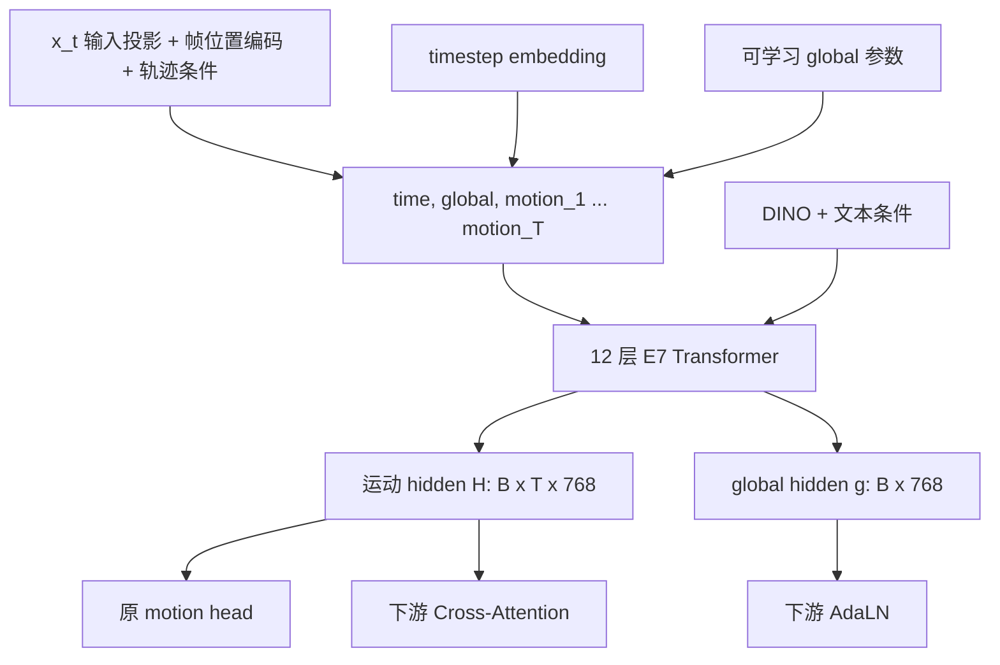

# E7-K12-400M Global Token 训练与推理方案

状态：global 主干版本已实现并完成短流程验证；300 epoch 完整训练尚未运行。本文件记录正式训练和后续验收要求。

## 1. 确定的方案

在 E7 主干中直接增加一个可学习的 `<GLOBAL>` token，使其与全部运动 token 逐层双向交互，保留原有训练目标，完整重训 MotionExpert。

训练完成后提供两路特征：最后一层全部运动 hidden 交给下游 Cross-Attention，最后一层 global hidden 交给下游 AdaLN。下游模块由使用者自行设计，本项目负责特征的训练、提取和导出。

本版本的边界：

- 保留 E7 的 K12、400M 规模、文本条件、MoE、x0 Flow Matching 和 10 步 Euler 推理。
- 主干内增加一个 global token，所有有效模型参数从训练开始共同更新。
- 沿用原 motion loss 和 MoE 均衡损失，不增加 global 重建、运动统计、对比学习或蒸馏损失。
- 直接输出主干的 global hidden，不增加末端 Cross-Attention、可学习汇聚头或额外预测头。
- 不将 global 输出反馈到新的 motion AdaLN 分支，不增加新的训练阶段或实验架构。
- 完整重训配置以随机初始化为默认；DINO 和 CLIP 继续使用预处理特征，不重训这两个编码器。

## 2. 现有模型与改造目标

| 项目 | 当前实现 | 本方案 |
| --- | --- | --- |
| 主干 | 12 层，768 维，12 heads | 保留 |
| 运动表示 | 每帧 153 维，K12 + 45 维辅助量 | 保留 |
| MoE | 每层 1 shared + 11 routed，Top-2，4 帧 chunk | 保留 |
| 输入序列 | `[time, motion_1, ..., motion_T]` | `[time, global, motion_1, ..., motion_T]` |
| DINO 条件 | 帧对齐的 1024 维特征 | 保留 |
| 文本条件 | 16 个 768 维 CLIP token，经 cross-attention 注入 | 保留 |
| 运动输出 | `[B,T,153]` | 保留 |
| 对外 hidden | `[B,T,768]` | 保留，只包含运动 token |
| 全局输出 | 无 | `[B,768]` |
| 损失 | masked 加权 x0 MSE + MoE 均衡项 | 保留公式及权重 |
| 默认特征时刻 | 第一次模型调用，`t=1` | hidden 和 global 同时从这次调用提取 |

“全部 hidden”在本方案中指最后一层的全部 T 个运动 token，不包括 time/global 前缀，也不拼接全部 12 层的输出。

新增参数仅为一个存储形状 `[768]` 的 `global_token`，前向时视图化并扩展为 `[B,1,768]`。如果不增删其他参数，模型总参数量从 403,789,365 增至 403,790,133。增加序列长度也会增加少量计算，实际吞吐和显存占用需要测量。

## 3. 主干结构

### 3.1 Token 构造与交互

新增 `nn.Parameter`，建议以标准差 `0.02` 的正态分布初始化，前向时沿 batch 维展开。这个初始化值是工程起点，不是已验证的最优设置。



具体约束：

- global 可以读取所有有效运动 token；运动 token 也可以读取 global，保持双向交互。
- global 与 time 都经过现有各层计算，包括 DINO、文本条件的 cross-attention 和 MoE FFN。
- 真实帧仍使用原来的位置索引 `0 ... T-1`；在帧位置编码之后插入前缀，不整体平移帧位置。
- global 没有物理帧编号，不使用某一帧的轨迹或 DINO 特征作为专属输入。
- 不把 global 额外加入 DINO/text 的 K/V context，不改变原条件 context 的构造。
- global 不属于 153 维运动表示，不增加运动标签维度，不对它执行 Flow Matching 加噪或 Euler 积分。
- 每次模型调用都从同一个可学习参数重新展开 global；不跨采样步、窗口或样本保留隐藏状态。

### 3.2 最后一层输出

完成最后一层文本更新后，使用统一的前缀长度切分：

```python
num_prefix_tokens = 2
global_hidden = sequence[:, 1, :].contiguous()             # [B,768]
hidden = sequence[:, num_prefix_tokens:num_prefix_tokens + T, :].contiguous()
motion = output_process(hidden)                           # [B,T,153]
```

直接返回原始 global hidden。不要在仅供导出的 global 后面增加可学习的 LayerNorm 或 Linear；在本方案中，这些独立参数不参与 motion 预测，无法由原损失训练。下游可以在自己的适配模块中完成归一化和维度映射。

### 3.3 双前缀的 MoE 路由

当前 [model/core.py](model/core.py) 通过 `x[:,1:]` 提取物理帧，并只给辅助损失 mask 补一个前缀。仅修改序列拼接会造成路由条件错位，必须一起修改。

实施规则：

1. 将前缀数量作为明确的结构信息传入路由，校验 `序列长度 = 前缀数量 + T`。
2. 只对 `sequence[:,2:]` 的 T 个运动 token 构造原来的 motion/pose/ego/timestep 路由条件。
3. 4 帧 chunk 只按真实运动帧划分，time/global 均不占用 chunk。
4. 沿用现有前缀路由方法：从有效运动帧的路由条件计算序列均值，经过原 router 生成前缀 logits。
5. 将该 logits 展开到两个前缀。它们可以选择相同专家，但送入专家的 token 值不同；无需新增 global router。
6. shared expert、Top-2 选择及 routed gate 计算保持原样。
7. MoE 均衡项沿用“统计有效 token，包含前缀”的规则，把前缀 mask 从一个有效位置扩展为两个。公式和系数不变，统计中的有效 token 数随新增前缀增加。

### 3.4 Mask 语义

主干 self-attention mask 为 `[True, True, frame_attention_mask]`。两个前缀始终有效，真正的 batch padding 不能成为它们读取的有效运动内容。

必须区分以下三类 mask：

| Mask | 含义 |
| --- | --- |
| 序列/输出 mask | 哪些位置属于模型要处理的运动窗口，包括需要生成的未来位置 |
| 条件 mask | 哪些位置有可用 DINO、轨迹或文本条件 |
| 损失 mask | 哪些位置与特征具有有效监督标签 |

预测任务的未来 token 可以被 global 读取，即使未来没有图像条件。不能用 `valid_img_embs` 或仅观测前缀作为运动 token 的 attention mask。

当前 [任务条件工具](utils/task_conditioning.py) 会让 fore/gen 关注完整输出窗口，同时保留原始标签 padding 信息。新增导出接口必须保留这种区别：请求生成的未来帧属于输出，单纯为 batch 对齐添加的尾部 padding 不属于输出。

按当前 fore/gen API，T 就是请求的完整输出长度，其标签 padding 不等于 batch padding；不能仅因为某个未来位置没有真值，就屏蔽该运动 token。

## 4. 原损失为何可以训练 global

令 `H_l` 和 `g_l` 分别表示第 l 层结束时的运动与 global 状态。双向 attention 允许：

```text
g_l -> H_(l+1) -> ... -> H_L -> motion prediction -> L_motion
```

因此，初始 global 参数和中间层 global 路径可以从原运动任务获得梯度，不需要额外构造 global 标签，也不需要强制将全部运动信息压缩到一个 token。

需要准确区分两个结论：

- global 参与运动预测的计算，所以可以被原目标训练。
- global 最终是否形成适合下游 AdaLN 使用的表示，需要通过下游任务验证，不能由 token 名称或梯度非零推出。

在现有块结构中，最后一层 global 与 motion 输出都是从上一层状态计算而来；若最终 `g_L` 仅被导出，motion loss 对这个最终输出节点没有直接梯度。它之前的交互路径和共享参数仍被训练，不能据此说 global 参数完全没有梯度。梯度验收应检查初始 `global_token` 参数，而不是要求 `g_L.grad` 非零。

在其他 Transformer 中，额外 token 参与主干、最终不直接用于监督输出的机制已有实践，例如 [Vision Transformers Need Registers，第 2.2 节](https://arxiv.org/html/2309.16588v2#S2.SS2)。该工作支持这种训练机制可行，不代表已经验证本方案在 E7 或指定下游上的收益。

## 5. 完整训练策略

### 5.1 保留训练目标和采样方式

```text
x_t = (1 - t) * x_0 + t * epsilon
t = 0.001 + 0.999 * Beta(1.5, 1.0)

L_total = L_motion + 0.005 * L_moe
```

`L_motion` 完全沿用 [现有实现](mydiffusion/flow_matching.py)：使用有效帧和有效特征 mask，对 x0 预测计算加权 MSE；每个样本的分母仍为有效损失权重之和，然后进行 batch 平均。

运动特征切片 `[108:117]` 的权重保持 `8.0`，其余有效维度权重为 `1.0`。这里原有的 global motion 特征权重及日志 `global_mse` 指运动表示中的 9 维全局变换，与新增 global token 无关。

保留当前条件 dropout 与文本 dropout，不在本版本引入新的任务采样器、global dropout、末端读取层，或固定比例的 `t=1` 训练样本。单独验证 `t=1` 的特征表现，但不因此改变原训练时间分布。

### 5.2 参数更新与完整重训配置

默认从随机初始化开始，所有有效参数从第一个训练阶段更新。global token 归入现有 `unfrozen` 参数组，设置 `SHARED_UNFREEZE_EPOCH=0`、`UNFREEZE_RAMP_EPOCHS=0`，确保训练阶段设置不会意外冻结它。

无实际前向用途、仅为旧权重兼容保留的参数继续冻结；“全参数训练”指所有参与本模型计算的有效参数。新增 global 不单独设置预热任务或高学习率参数组。

| 设置 | 完整重训建议初值 |
| --- | --- |
| 初始化权重/恢复路径 | 均为空；通过 `--from-scratch` 启动新训练 |
| 优化器 | AdamW，weight decay `0.01` |
| 峰值学习率 | `1e-4` |
| routed/text/unfrozen LR 倍率 | 均为 `1.0` |
| 日程 | 300 epoch，20 epoch warmup，之后 cosine，最小 LR 比例 `0.1` |
| 批量 | 每卡 16，8 卡，梯度累积 4，有效 batch 512 |
| 精度/裁剪 | BF16 mixed，梯度裁剪 `1.0` |
| EMA | 沿用 `0.992028`，包含新增 global 参数 |
| MoE 初始化 | 保留现有模块初始化，包括 routed gate 初值 `0.05` |
| 数据 | 使用全部通过 QC 的训练窗口，保持两来源平衡采样 |

学习率和日程是供首次完整训练采用的起点，不是已验证的最佳配置。当前 YAML 默认用于已有 E7 权重微调，不能仅追加 global 开关后仍默认加载旧权重、沿用微调 LR 倍率。数据量增加时，应同时记录实际 optimizer step 数，不能只用 epoch 数比较训练预算。

正式配置为 `configs/e7_k12_400m_global_text.yaml`，明确标记 global 架构，不恢复之前已清理的实验或消融配置。该配置可直接用于从随机初始化启动本方案。

### 5.3 数据通路

沿用 [README](README.md) 中的输入约定：

- EE4D 与 NymeriaPlus motion pack、对齐的 DINO sidecar、CLIP 文本 sidecar、QC 清单和训练集归一化统计。
- 10 FPS 运动、80 帧窗口、20 帧步长；模型输入 DINO CLS 为 `[B,T,1024]`，轨迹为 `[B,T,18]`。
- 文本 token 为 `[B,16,768]`，保留 `text_mask`、`text_valid` 和 `0.10` 文本 dropout。
- 关闭 `DATA.SOURCE_SUBSAMPLE.ENABLED`，使用全部合格训练窗口；来源权重维持 EE4D/NymeriaPlus 各 `1.0`。
- NymeriaPlus 缺失的手部 PCA、体型及其他无效特征继续通过 feature mask 处理；加噪和监督均不得把无效维度当成真实观测。
- 验证集使用训练集统计；沿用序列级划分，避免同一序列的重叠窗口跨训练/验证集泄漏。

训练入口继续消费预处理特征；推理入口继续支持缓存文本特征或原始文本。新增 global 无需新增任何数据标注。

## 6. 特征与推理接口

### 6.1 提取时刻

保留现有首次调用语义，hidden 和 global 必须来自相同权重、同一份初始噪声、同一组条件和同一次前向：

```text
H_1, g_1 = MotionExpert(noise, t=1, conditions) 的主干输出
```

这里的下标 1 表示首次采样调用，不是第 1 个 Transformer 层。实际导出的是该次调用最后一层的输出。

此时运动输入为噪声，两个特征是条件与当前采样状态的表示，不是把真实 motion 输入模型后得到的编码。不得在下游训练中用接近干净 motion 的 hidden 替代它，又在部署时换回 `t=1`。

global 表示当前窗口，不是整个视频的跨窗口记忆；80 帧以外的内容不会自动进入这个 token。不同采样种子可以得到不同 global，不强制整个向量跨种子一致。

### 6.2 模型内部返回约定

训练默认前向仍只返回 `[B,T,153]` 的 motion 预测，原 `training_losses` 调用方式保持不变。global 始终参与主干计算，是否返回它不影响其训练路径。

保留现有 `return_hidden=True` 的二元返回约定，新增明确的特征返回选项，例如 `return_features=True`，一次返回 motion、hidden、global。两种返回选项应互斥并有参数校验，避免采样器将 tuple/dict 当成 motion Tensor。

不需要每一层或每个采样步骤都额外导出 global；默认只保留第一次模型调用的这组特征。

### 6.3 两种推理用途

| 用途 | 执行内容 | 主要输出 |
| --- | --- | --- |
| 完整运动推理 `sample` | 原有 10 步 Euler，保留首次特征 | `motion`、`one_step_hidden`、`one_step_global` |
| 特征提取 `extract_features` | 只执行一次 `t=1` 模型前向 | `one_step_hidden`、`one_step_global` |

默认输出约定：

```text
motion           [B,T,153]  完整采样结果，仅 sample 提供
one_step_hidden  [B,T,768]  首次调用的全部运动 hidden
one_step_global  [B,768]    首次调用的 global hidden
feature_mask     [B,T]      与导出 hidden 对应的有效输出位置
metadata                    特征时刻、任务、种子、CFG 设置、权重版本
```

一次前向中的 x0 估计不能标成完整 10 步采样结果。完整 `sample` 继续支持反归一化及保存每步 x0 估计；这次新增 global 不改变 motion 的物理表示和输出长度。

当前包装器和采样器分别使用 `inference_mode`/`no_grad`，它们属于推理通路。未来下游需要训练 MotionExpert 时，应调用可微分模型前向；冻结专家、训练下游时优先在 `no_grad` 中提取普通特征 Tensor，避免直接依赖 inference-mode Tensor 参与需要保存输入的反向计算。

### 6.4 CFG 与任务模式

默认 `cond_scale=None`，输出普通条件分支特征。显式启用 CFG 时，为兼容现有 hidden 的外推语义，新增 global 采用相同规则：

```text
H_cfg = H_uncond + scale * (H_cond - H_uncond)
g_cfg = g_uncond + scale * (g_cond - g_uncond)
```

不能将 CFG hidden 与普通 conditional global 混为同一对特征。元数据记录是否使用 CFG；这种外推后的特征分布未被原损失单独训练，下游默认先使用无 CFG 特征。

保留 recon/fore/gen 的推理条件规则。fore 不能读取未来的 DINO 或轨迹条件，gen 保留原先的首帧图像与文本语义；global 与运动 token 遵守同一组可见条件。它不会因为是特殊 token 就绕过条件 mask。

## 7. 检查点、恢复与导出

拟使用架构标识 `e7_k12_400m_global_text_v1`。在检查点和导出元数据中保存 global 数量 `1`、序列前缀数 `2`、hidden 维度、K12 顺序、特征提取时刻及训练配置，并继续携带归一化统计。

新增参数建议固定命名为 `global_token`，存储形状为 `[768]`，前向 token 形状为 `[1,1,768]`。优化器分组、EMA 顺序与 [checkpoints.py](checkpoints.py) 的参数分组判定必须一致；采用现有 `unfrozen` 组即可，不需要新增一种分组。

完整恢复必须恢复模型、global 参数、optimizer、scheduler、EMA 和训练进度。新增架构不能直接使用旧 E7 的 optimizer/EMA 状态恢复；参数数量和顺序已改变。本方案的新训练从随机初始化开始，不进行旧状态的隐式迁移。

导出器和推理包装器当前会构造固定的旧 E7，需要改为依据检查点/导出元数据构造正确架构，再严格检查权重。旧权重仍属于旧架构；不能用 `strict=False` 默默留一个随机 global，并把它标成训练完成的 global 模型。

导出的 EMA 权重必须包含 `global_token`。从原检查点直接推理与从导出权重推理，在相同设置下应产生一致的 motion、hidden 和 global。

## 8. 实施顺序与文件范围

| 顺序 | 文件 | 改造内容 |
| --- | --- | --- |
| 1 | [config.py](config.py)、正式 global YAML | 已完成：架构标识、global 数量、完整重训设置、结构校验 |
| 2 | [model/uniegomotion.py](model/uniegomotion.py) | 已完成：global 参数，双前缀拼接、切片和特征返回，CFG 扩展 |
| 3 | [model/core.py](model/core.py) | 已完成：前缀数量显式化，物理帧 chunk 对齐，双前缀路由与辅助 mask |
| 4 | [module/uem_module.py](module/uem_module.py)、[train.py](train.py) | 已完成：全参更新、optimizer 收录 global；保留原损失与默认返回通路 |
| 5 | [mydiffusion/flow_matching.py](mydiffusion/flow_matching.py) | 已完成：保留训练数学定义和 Euler；提取首次 hidden/global |
| 6 | [motion_expert.py](motion_expert.py)、[infer.py](infer.py) | 已完成：同步输出、一次前向特征接口、mask 与元数据、CLI 序列化 |
| 7 | [checkpoints.py](checkpoints.py)、[ema.py](ema.py)、[export_weights.py](export_weights.py) | 已完成：架构识别、EMA 完整性、严格恢复与导出 |
| 8 | [tests/test_pipeline.py](tests/test_pipeline.py)、[tests/test_global.py](tests/test_global.py)、[README.md](README.md) | 已完成：回归测试和实际可运行的训练与推理命令 |

CLI 当前主要按 Tensor/list 转存输出。加入 metadata 字典后需要按类型处理，不能继续把所有非 Tensor 值当作 Tensor 列表。

结构、梯度、损失等价性、真实两来源短流程、恢复、导出和两类推理均已通过；下一步是启动完整训练并记录运动和下游指标。所有步骤使用同一正式架构，不新增实验分支。

## 9. 验收要求

### 9.1 结构与梯度

- 输入 T 帧时，主干长度为 `T+2`；运动输出和对外 hidden 长度仍为 T，global 形状为 `[B,768]`。
- 使用至少两层的双向主干，只对原 motion loss 反向，检查初始 `global_token` 获得有限且非零的梯度。关闭 MoE 均衡项参与该检查，排除仅辅助项提供梯度的误判。
- 执行一个 optimizer step 后确认 global 参数实际变化，并被纳入 EMA；不能只检查其 `requires_grad=True`。
- 不要求最终导出节点 `global_hidden.grad` 非零，也不以 token 参数有梯度作为下游有效性的证明。
- 检查 time/global 没有混入 4 帧 chunk；在同一组路由条件下，双前缀之外的帧路由与逐帧条件保持对齐。
- 在相同预测张量、目标和 mask 下验证 motion loss 数值计算未改变；不能要求新增 token 后与旧模型的预测完全一致。

### 9.2 数据、训练与恢复

- EE4D 和 NymeriaPlus 均通过真实数据的前向、反向与验证，覆盖有效特征 mask、空文本和短窗口。
- 保留现有数据回归测试，新增对 padding 内容不影响有效输出/global 的检查；关闭 dropout 后验证，且只对真正的 batch padding 应用该断言。
- 先完成单卡 BF16 短流程，再完成多卡 DDP；检查 global 梯度同步、loss 有限和专家路由负载。
- 完成保存、恢复并继续 optimizer step，确认 global、EMA、scheduler 和步数均正确恢复。
- 原权重被误当成新架构加载时明确报错；新 EMA 导出包含 global，重新加载后结果一致。

### 9.3 推理与实际效果

- 完整采样仍为 10 步 Euler；特征接口在默认无 CFG 下只调用一次主干。
- 在同一 seed、条件、精度和权重下，特征接口与完整采样的首次 hidden/global 一致。
- 覆盖 recon/fore/gen、不同有效长度及 CFG，检查特征对齐、mask 和数值有限性。
- 正式训练分别报告两来源的原运动指标，以及 `t=1` 特征的数值分布、跨样本变化和范数；这些只作为诊断，不形成新损失。
- global 对 AdaLN 的价值由实际下游任务指标判断。注意力覆盖广、向量方差非零或 motion loss 下降，都不能单独证明全局指导有效。

当前可以报告通路验证结果，不能将短流程指标当作完整训练结果；完整训练后仍应分别报告原运动任务表现和下游使用 global 的表现。

## 10. 当前不实施的扩展

末端以 global 为 query 再读取全部 hidden 的 Cross-Attention，不属于本次确定方案。若未来需要这种可学习读取，必须另外确定它如何获得梯度；不能在专家训练结束后随机追加一层，就把其输出当成训练完成的全局特征。

本版本只实现主干内的 global token，并用原任务训练它。是否扩展读取方式，由后续真实下游表现决定。
