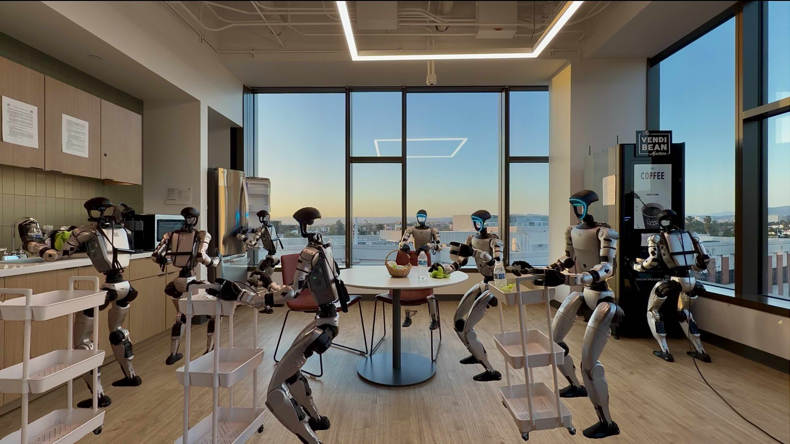
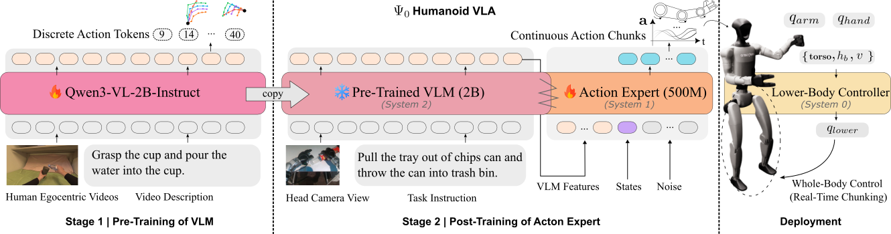

## 本仓库扩展：双来源 Action Expert

A100的Handover任务适配见[38k联合权重初始化、任务微调20k步](../docs/A100_SIMPLE_TASK50_FINETUNE.md)：
保留已训练动作头、VLM及Motion，八卡batch32，每4k保存，沿用原归一化并记录本地损失和实测ETA。
融合AdamW的完整状态对照、checkpoint边界暂停及数据流恢复规则也记录在该文档中；
默认新任务入口仍使用普通AdamW，恢复入口只在验证报告通过后启用fused。
当前独立38k融合重跑已通过同梯度优化器对照和八卡第2、20步检查并保存20步恢复快照；
这是用户接受重算后从任务第0步开始的新运行，完整20k训练和物理效果尚未验收。
38k任务首次保存前故障的重跑使用独立`a100_task_fused_restart.py`入口：受控同梯度验证通过后
从任务0步重建优化器，不继承UnifoLM优化器或冒充恢复2345步；保存及诊断规则见上述任务文档。

`action_architecture="dual_source_v1"` 实现双来源串行结构。当前 UnifoLM 配方设置
`tune_vlm=True, tune_motion=True`，联合更新 VLM、MotionExpert 与新 action expert；DINO 保持冻结。
两套 expert 也可分别通过 `tune_vlm=False`（不设置 `tune_mm_*`）、`tune_motion=False` 固定为 `eval/no_grad`。
原官方架构仍用 `action_architecture="psi0_joint"`，默认值保留以便读取旧模型。

每个 block 执行 `Action Self-Attention → Cross-Attention VLM → Cross-Attention Motion → FFN`。
四个分支各有 AdaLN 和门控残差；每层独立 `ModHead` 输出四组 `gamma/beta/g`，共 `12d`。
调制采用 `(1 + gamma) * LayerNorm(x) + beta`。仅调制头零初始化，attention／FFN 的输出投影
和最终动作 linear 保留常规初始化，避免与零 gate 形成永久无梯度分支。

- `H_V [B,1,N,Dv]`：固定使用 VLM 最后一层的完整多模态序列，padding 同时从均值和注意力排除。
- `H_M [B,11,768]`：MotionExpert 在自身 `t_M=1` 完整高斯输入上前向一次，包含全部历史6／未来5位置。
- `p_V` 为有效 VLM tokens 均值，`p_M` 为全部11个 motion tokens 均值，不使用未来标签 mask。
- 两路摘要分别归一化、投影，与 action 时间 embedding 拼接，经 `f_fuse` 得到调制条件；旧 CLIP 分支不参与。
- 两路完整 memory 独立归一化、投影后供 cross-attention 读取，各 block 不更新 memory。
- 当前 proprio state 投影为 action 序列首 token，输出前移除。RTC 保留逐 action token 时间，
  已知动作前缀及 state 使用 `time_embed(0)`。

首次新建模型示例（先将 `vlm` 加载为需要的 EgoDex 微调权重）：

```python
from psi.config.model_psi0 import Psi0ModelConfig
from psi.models.psi0 import Psi0Model

cfg = Psi0ModelConfig(
    action_architecture="dual_source_v1",
    model_name_or_path="/absolute/path/to/egodex-vlm",
    motion_checkpoint="/absolute/path/to/motion.ckpt",
    motion_use_ema=True,  # 初始化采用所选权重身份；之后该网络参与联合训练
    tune_vlm=True,
    tune_motion=True,
    lang_backbone_lr=1e-6,
    vision_tower_lr=1e-5,
    mm_projector_lr=1e-4,
    motion_expert_lr=1e-5,
    view_feature_dim=vlm.config.text_config.hidden_size,
    n_conditions=0,
)
model = Psi0Model(cfg, vlm).to("cuda").train()
output = model(
    input_ids=input_ids, attention_mask=attention_mask,
    pixel_values=pixel_values, image_grid_thw=image_grid_thw,
    action_samples=noisy_actions, states=states, timestep=action_t,
    motion_img_embs=motion_img_embs,  # [B,6,5,1024]
    return_vlm_features=True,
)
# output.action, output.vlm_features.p_v, output.motion_features.p_m
```

`motion_img_embs` 必须是六个真实5Hz历史时刻的 DINO CLS＋4 register 特征，最后时刻对应 VLM 当前帧。
两路当前帧必须同源、同时间，并遵循同一几何 profile；DINO 权重身份、归一化和视觉尺寸必须遵守
Motion checkpoint 的视觉协议，跨尺寸适配须显式声明。接口不会从张量形状推断这些来源关系。
标准 transform／collator 会保留并堆叠该字段，三个 action trainer 会转交给模型。
UnifoLM 的 LeRobot wrapper 在配置 `dino_cache_root` 后，会从原生缓存读取历史，无需把整份特征写入 Parquet；
当前 RGB 如何处理由 `Psi0ModelTransform.motion_image_policy` 显式选择：

- `shared_rgb`（兼容默认值）：`observations` 已是上游共享窗口处理后的当前 RGB；模型不再改变几何或颜色，
  关闭本地 `img_aug/view_aug`。若增强 Motion 输入，六帧共用同一组增强参数并在线编码冻结 DINO。
- `vlm_color_clean_motion`（当前 UnifoLM 配方）：wrapper 只恢复当前帧的原始分辨率 uint8 RGB，不预先 resize；
  模型调用 `SharedImageProcessor(profile).process_window([current], stage="posttrain", training=img_aug and not no_aug)`，
  依次执行 resize 到240×320、Ψ₀颜色增强、最终对齐到256×320。`img_aug=True` 只增强 VLM 当前帧，
  Motion 历史六帧全部复用 clean DINO 缓存；不启用 `view_aug`、Robust随机裁切或 `adaptive_resize`。
  验证／`no_aug`／推理关闭随机颜色，保留同一确定性几何。

颜色参数由 ImageProcess profile 定义，legacy `color_jitter.*` 必须与其匹配，否则配置校验拒绝。
增强 seed 从 Torch worker RNG 派生，记录该 seed 可重放对应的颜色增强。
新策略保留同源、同时间、同几何的对应关系，但训练时两路不再复用同一份颜色增强后的 RGB。
现有单帧数据源不会自动得到历史，缺失时明确报错，不复制当前图或读取未来标签。

训练每个 batch、四种 `predict_action*` 采样及三个 trainer 的评估入口均只提取一次两路特征；
去噪循环复用它们。`motion_feature_seed=0` 仅用独立 RNG 生成固定初始运动噪声；
联合训练中的 dropout／router jitter 仍正常消耗训练 RNG；
初始运动噪声在相同 batch 布局下可复现，重排 batch 会改变样本对应的噪声位置。
需要复用时可先调用 `extract_motion_features(motion_img_embs=...)`，再传 `motion_features=...`；
`forward` 也接收本模型 `extract_vlm_features()` 产生的 `vlm_features`。
复用特征必须属于同一观察窗口。联合训练时 tokens 与均值都保留 source graph，禁止用
`detach/no_grad/inference_mode` 的缓存替代可训练来源；每次 optimizer 更新后重新提取，不能复用旧图。
采样遵守外部 `no_grad/inference_mode`，各去噪步仍共用同一次观察提取。

新模式拒绝 layerwise VLM、旧 DiT／CLIP／FiLM／traj2ds 条件。
state dropout 大于零时需启用 `state_null_token=True`，缺失 state 使用专门的 null token。
新 head 的 tensor 架构签名可随 safetensors 保存；旧 joint head、缺参数或配置不匹配的权重会被拒绝，
包括 `strict=False`。默认 posttrain 仍从头训练新 head，不恢复旧 optimizer。
完整 checkpoint 包含联合更新后的 Motion 网络权重；恢复时仍需显式原 Motion checkpoint 来重建其配置和统计协议。
从本目录直接运行需 `PYTHONPATH=src:..`，或在专用环境安装仓库根目录的 MotionExpert 包。

从已后训练的联合模型开始一个独立任务适配时，显式设置
`model.pretrained_joint_checkpoint=/绝对路径/run/checkpoints/ckpt_28000/model.safetensors`。
PosttrainTrainer 此时严格加载已有 VLM、MotionExpert 和 ActionExpert，保留其架构签名和共享权重；
Qwen 目录只需本机 config／processor，Motion checkpoint 提供构造与统计协议。
优化器、scheduler、RNG 与任务步数重新初始化，不能同时设置 `train.resume_from_checkpoint`、
单独的 action-header 路径或 LoRA。未设置该字段的现有 A100 配方行为保持不变。
冻结 VLM 时沿用 BF16；训练 VLM 时直接载入 FP32 master，避免先经 BF16 舍入。
本机 CarryBox 流程与独立保留测试见 [4090 环境工具](../scripts/4090_simple/README.md)。

### UnifoLM 下载、DINO 提取与读取

数据根目录为 `/gaozt-test1/datasets/UnifoLM`，与 EgoSuite、EgoExo-4D-HM 等并列。
使用 [官方 SONIC 数据包](https://huggingface.co/datasets/USC-PSI-Lab/psi-data/tree/e78fb93cc28912a3031a10b8656d32d7f0a2b867/sonic)，
固定 revision `e78fb93cc28912a3031a10b8656d32d7f0a2b867`。训练 ZIP 为38,855,909,476字节，
下载准备脚本按8MiB持久分块保存，校验每次 HTTP 206 的范围与完整长度，失败只重试当前块；
重跑复用已完成且本地 SHA 匹配的块。最终以官方整包 SHA256、解压 CRC 和 train/val 共享统计验收，
安全拒绝越界 ZIP 或符号链接残留。本地分块 SHA 用于恢复校验，不是官方分块校验值。
脚本只准备数据，不启动训练；已存在的数据需通过原成员 CRC 才能复用。

```bash
# 从仓库根目录运行；下载仅使用 Python 标准库，数据与缓存始终在仓库外。
python VLMExpert/scripts/data/prepare_unifolm.py --root /gaozt-test1/datasets/UnifoLM
# 默认64个并发请求，可用 --download-workers 调整；完成块保存在 .pipeline/downloads。
# 已完整下载时可用 --skip-download，只校验与解压。
```

两套 pack 保留官方 action/state/SONIC1.1 tokens、split 与元数据。目录布局：

```text
/gaozt-test1/datasets/UnifoLM/
  archives/official/sonic/           # 固定版本 ZIP
  unifolm_sonic_lerobot_train/      # 原始 LeRobot pack
  unifolm_sonic_lerobot_val/
  dino/256x320/
    unifolm_sonic_lerobot_train/
      manifest.json
      episodes/00000000/{features.npy,frames.npz,receipt.json}
    unifolm_sonic_lerobot_val/
  .pipeline/                       # 下载／提取日志、收据及本机验证记录
```

**DINO 缓存与 Ψ₀ 读取端共用 `data.shared_image_profile`，当前为 `256x320`。**
唯一几何来源是 [ImageProcess 配置](../ImageProcess/configs/256x320.json)：
最终输出 H256×W320；DINO 只再做自己的 rescale／ImageNet normalization，关闭二次 resize/crop。
模型 transform 绑定同一 profile。`shared_rgb` 接收已处理的 uint8 当前 RGB；
`vlm_color_clean_motion` 接收原始分辨率 uint8 RGB，在模型 transform 内按该 profile 完成几何和颜色，避免重复 resize。
完整 profile/hash/实现、NumPy/Pillow 版本、DINO 本地权重/config SHA 和原始视频／Parquet 身份随缓存保存。
提取与读取需匹配 Ψ₀ `uv.lock` 的 NumPy1.26.4／Pillow11.3.0；不一致会明确拒绝。
视频解码使用同一 `uv.lock` 的 PyAV16.0.1。本机验证集早先由 PyAV17.1.0 提取，
已与16.0.1逐帧比对全部4688帧的 RGB、PTS 和时间戳，完全一致，可继续使用。
这次后训练使用与 Motion 预训练 H256×W480 相同的 DINO 权重，并显式适配到 H256×W320；
原 Motion 预训练的图像配置和缓存不修改。

```bash
python VLMExpert/scripts/data/extract_unifolm_dino.py \
  --dataset-root /gaozt-test1/datasets/UnifoLM/unifolm_sonic_lerobot_val \
  --output /gaozt-test1/datasets/UnifoLM/dino/256x320/unifolm_sonic_lerobot_val \
  --model-path /gaozt-test1/datasets/MixEgoMotion/weights/dinov2-with-registers-large/e4c89a4e05589de9b3e188688a303d0f3c04d0f3 \
  --shared-image-profile 256x320 --device cuda:0 \
  --batch-size 32 --workers 4 --inference-precision bf16 --storage-dtype float16
# 提取训练集时把 dataset-root/output 的 pack ID 换为 unifolm_sonic_lerobot_train。
```

每个 episode 保存**所有原生30Hz**特征 `[T,5,1024]`，不保存 Motion hidden，后续 Motion 可继续联合训练。
当前配置使用 BF16 encoder inference／FP16 存储，读取时每次复制六行；DINO 参数冻结。
同一批参数可以通过 `--num-shards N --shard-index I` 分配到多个独立 GPU 进程共写同一输出根目录，
所有 shard 必须使用同一 profile、权重、精度与 episode 选择。每个 episode 有独立锁，
写入完成后才提交 receipt；只有所有 episode 齐全才把 manifest 标为 complete。
原参数重跑会复用已提交 episode，未完成 episode 重新提取；来源或配置改变时拒绝复用。

本机训练缓存已由8张 A100、8个 shard（每卡 batch64）完成：7244个 episode、
5,416,386帧，完整有效历史对应5,199,066个训练样本。全量特征有限性、SHA256、
原生帧／时间戳绑定和历史窗口检查已通过，详见
[`unifolm_train_dino_final_validation.json`](/gaozt-test1/datasets/UnifoLM/.pipeline/unifolm_train_dino_final_validation.json)。
已验收的缓存继续复用；后续启动前检查 manifest 和身份，不重新提取。

训练读取设置：

```python
# LerobotDataConfig 字段；动作、state 与原来的 delta_timestamps 查询保持一致。
dino_cache_root = "/gaozt-test1/datasets/UnifoLM/dino/256x320"
shared_image_profile = "256x320"
dino_max_open_episodes = 8

# Psi0ModelTransform 字段，位于 data.transform.model：
motion_image_policy = "vlm_color_clean_motion"
img_aug = True
view_aug = False
adaptive_resize = False
```

wrapper 按原始 row/episode/frame/timestamp 建立过滤映射，逐时刻取
`t-1.0, t-0.8, t-0.6, t-0.4, t-0.2, t`，返回 `[6,5,1024]` 的 `motion_img_embs`；
VLM 当前帧保持原动作查询的30Hz时刻。缺少真实一秒历史、跨 episode、缺帧、时间断点、
任一中间原生帧无效的窗口都排除，不重复首帧、不借未来图像。
过滤后的任务采样权重及 episode 迭代同步调整；官方 split 元数据遗留的旧全量范围不用于本地行映射。
特征以每 worker 有界 LRU/mmap 按需读取，不预载整份缓存。
离线缓存始终使用 clean RGB，不含随机颜色或裁切。`shared_rgb` 模式继续拒绝本地 `img_aug/view_aug`；
当前 `vlm_color_clean_motion` 模式允许 VLM 独立 `img_aug=True`，Motion 全历史仍保持 clean。
该策略不改变缓存 extractor、metadata 或特征字节，不需要重新提取；DINO 冻结不妨碍 MotionExpert 联合训练。
只有改为增强 Motion 输入时，才需在线编码同步增强后的六帧，不能在 clean DINO 特征上补做等价颜色增强。
数据与 GPU 验证范围见 [UnifoLM 验证记录](../docs/unifolm_dino_validation.json)。
新颜色策略的 CPU 验证见 [UnifoLM 分支增强验证记录](../docs/unifolm_vlm_color_validation.json)。

### UnifoLM 联合训练配方

使用 [posttrain-dual-source-unifolm.sh](scripts/train/psi0/posttrain-dual-source-unifolm.sh)，
必须显式提供 EgoDex VLM、Motion checkpoint、UnifoLM 数据路径／ID，以及
`UNIFOLM_DINO_CACHE=/gaozt-test1/datasets/UnifoLM/dino/256x320`；
脚本的 `--dry-run` 只打印命令，`--check-only` 先检查输入再打印命令，两者均不启动训练；
`MOTION_USE_EMA=1/0` 指定初始化权重选择。
数据 wrapper 自动把已完成的原生 DINO 缓存接入 `motion_img_embs`，并将同源、同时间的当前 RGB 交给所选策略处理；
缺少或未完成的缓存明确报错，下载 ZIP 本身不会自动产生 DINO。

#### 本机固定初始化

[unifolm-local.env.sh](scripts/train/psi0/unifolm-local.env.sh) 固定本次选用的本地 Qwen3-VL
（目录名含 `ego200k.he30k`）、MotionExpert 第100轮（`epoch=99-step=48700.ckpt`，EMA）、train／val 数据与缓存路径，
以及已对齐的独立 Python3.11／Torch2.7 环境。该文件只导出配置，不创建环境或启动训练。
`UNIFOLM_RUN_ROOT` 将训练输出设为仓库外的 `/gaozt-test1/datasets/UnifoLM/.pipeline/training`。
从仓库根目录检查输入与最终命令：

```bash
source VLMExpert/scripts/train/psi0/unifolm-local.env.sh
bash VLMExpert/scripts/train/psi0/posttrain-dual-source-unifolm.sh --check-only dual_source_unifolm_local
```

本地权重验收记录为
[`posttrain_initialization_weights.json`](/gaozt-test1/datasets/UnifoLM/.pipeline/posttrain_initialization_weights.json)，
包含路径、大小、mtime、完整 SHA256 及 tokenizer／processor 身份。Qwen 当前实测 SHA256 为
`db31e5dd953f68febc11330f5a436a37d3bd02b735e206503f2cf000faad616c`，与旧 HF 下载旁路记录不同；
本次保留用户选定的本地文件，不将该 SHA 声称为远端官方校验通过。
配置中的 `UNIFOLM_INIT_WEIGHTS_RECORD` 使 `--check-only` 和实际启动先核对权重路径、大小、mtime、
tokenizer／processor 小文件哈希及 EMA 选择；检查通过不表示环境或 GPU 联调已通过。
如文件发生变化或需要重新校验，可手动运行以下完整哈希检查，
无需在每次训练启动时重新扫描约10GB权重：

```bash
printf '%s  %s\n' \
  "$EGO_DEX_VLM_SHA256" "$EGO_DEX_VLM_PATH/model.safetensors" \
  "$MOTION_EXPERT_SHA256" "$MOTION_EXPERT_CHECKPOINT" | sha256sum --check
```

独立环境位于 `/gaozt-test1/datasets/UnifoLM/.pipeline/runtimes/psi0-py311-torch270-cu126`，
使用 Python3.11.15、Torch2.7.0/CUDA12.6、Torchvision0.22.0、Transformers4.57.1、
Accelerate1.7.0 和 FlashAttention2.7.4.post1。NumPy1.26.4、Pillow11.3.0、PyAV16.0.1
与缓存图像处理环境一致；LeRobot 固定在 `09929d8057b044b53aecaf5c6d7eb71f99e8beb9`，
`psi` editable 指向当前仓库。旧环境保留。环境重建可在仓库根目录执行：

```bash
source VLMExpert/scripts/train/psi0/unifolm-local.env.sh
UV_PROJECT_ENVIRONMENT="${PSI_PYTHON%/bin/python}" uv sync \
  --project VLMExpert --group psi --locked --python 3.11 --inexact
uv pip install --python "$PSI_PYTHON" --no-deps \
  'https://github.com/Dao-AILab/flash-attention/releases/download/v2.7.4.post1/flash_attn-2.7.4.post1%2Bcu12torch2.7cxx11abiTRUE-cp311-cp311-linux_x86_64.whl'
```

该 FlashAttention wheel 对应 Python3.11、Torch2.7、CUDA12、C++11 ABI；后续同步环境保留
`--inexact`，避免删除单独安装的 FlashAttention。入口允许直接使用已导出的环境变量，`.env` 为可选补充。
真实处理器、LeRobot 解码及 collator 验收见
[`psi0_runtime_validation.json`](/gaozt-test1/datasets/UnifoLM/.pipeline/psi0_runtime_validation.json)。
缓存、固定初始化、环境及完整模型 GPU 联调四项均已完成。
2026-10-19已按用户授权启动八卡正式后训练，运行状态见下文。

#### 完整模型 GPU 验收

[完整验收记录](../docs/unifolm_full_model_validation.json) 使用上述本地 Qwen3-VL、Motion 第100轮 EMA、
真实 UnifoLM train／val 及完整 `1536×6` 双来源 action expert，共约30.13亿参数。
Motion 输入完整11个 hidden，并将其均值作为 `p_M`；VLM 使用最后层有效 token 及 masked mean `p_V`。
使用 A100 80GB、FP32 主参数、BF16 autocast 和 AdamW `foreach=False`，均累积2步；
单卡／双卡完成4次更新，新增八卡检查完成8次更新：

| GPU × 每卡 batch | 峰值 allocated／reserved（GiB，取各卡最大值） | 结果 |
| --- | --- | --- |
| 1 × 1 | 48.55／51.13 | 前后向、五个参数组更新、采样均通过 |
| 1 × 16 | 51.78／54.61 | 完整 batch 前后向与更新通过 |
| 2 × 1 | 59.94／62.63 | 连续4次更新后两卡完整模型 SHA256 每次均一致；实际使用 NCCL P2P |
| 8 × 16 | 63.15／65.95 | 8次更新后八卡完整模型 SHA256 每次均一致；五组参数均更新，实际使用 NCCL P2P |

2026-10-19 的 [八卡 batch16 验收记录](../docs/unifolm_8gpu_batch16_validation.json) 覆盖2048个不同训练窗口，
常规有效全局 batch为 `8×16×2=256`。八份报告全部通过，损失、clip前梯度和更新后参数均有限，
VLM／Motion 完整tokens及两个pooling分支均收到非零梯度；冻结参数与clean DINO输入保持不变。
PyTorch峰值 allocated／reserved 为63.15／65.95 GiB；另以1秒间隔采样 NVML，驱动占用最高67.07 GiB。
八卡采样与checkpoint保存通过，进程正常退出并释放全部GPU占用；本次没有重复八卡冷恢复。

单卡和双卡均从保存文件恢复完整模型、所有 AdamW 状态、scheduler 及 Python／NumPy／CPU／当前 CUDA RNG，
恢复后的同输入预测逐位一致，再完成1次真实更新；双卡续跑后完整模型 SHA256 仍一致。
双卡续跑峰值 allocated／reserved 为60.04／63.26 GiB。
另用 `Psi0Model.from_pretrained` 冷加载保存结果，按相同精度比较预测，最大差异为0，峰值 allocated 8.18 GiB。
同时修复了 Motion 共享位置编码被 safetensors 去重后无法严格加载，以及 Rich 日志文件链接消耗 Python RNG 的问题。
本环境的数据／运行时回归100项、最终 checkpoint／模型集成回归91项分别通过，两套检查有重叠。

可复用 [有限步数验收脚本](scripts/validation/validate_unifolm_full_model.py)；该入口只执行4～8次验收更新，
不调用正式训练循环。以下为八卡每卡batch16检查示例，输出仍放在仓库外：

```bash
source VLMExpert/scripts/train/psi0/unifolm-local.env.sh
CUDA_VISIBLE_DEVICES=0,1,2,3,4,5,6,7 NCCL_IB_DISABLE=1 NCCL_P2P_DISABLE=0 NCCL_SHM_DISABLE=0 \
  "$PSI_PYTHON" -m torch.distributed.run --standalone --nproc_per_node=8 \
  VLMExpert/scripts/validation/validate_unifolm_full_model.py --mode train \
  --batch-size 16 --accumulation 2 --updates 8 \
  --output-dir "$UNIFOLM_DINO_ROOT/.pipeline/runs/full-model-new-check"
```

上述显存来自独立的限定步数检查，不代表正式吞吐；历史验收JSON中的未启动标记是该报告生成时的状态。
GPU验收使用真实数据、collator和Accelerator，但在主进程解码（workers0），未验收正式多worker吞吐。
此前单／双卡恢复检查覆盖状态恢复和继续更新，未验收中断前后数据游标逐步重放。
HTTP／机器人历史缓冲的服务接线仍单独验收。

| 参数组 | 初始学习率 | 来源 |
| --- | --- | --- |
| 新 action expert | `1e-4` | Ψ₀ UnifoLM |
| VLM 语言主干 | `1e-6` | Ψ₀ UnifoLM |
| VLM 视觉主干 | `1e-5` | Ψ₀ UnifoLM |
| VLM 多模态投影 | `1e-4` | Ψ₀ UnifoLM |
| MotionExpert | `1e-5` | 本仓库新增的初始设定，可调 |

参考 [Ψ₀ 官方 UnifoLM 配方](https://github.com/physical-superintelligence-lab/Psi0/blob/cda3fdfafe47cb6fa75400d013de1bd36e3cea05/scripts/train/psi0/posttrain-psix-unifolm-g1-sonic1.1.sh)，
沿用 posttrain、40,000 步、1,000 步 warmup、每卡 batch 16、累积2步和 BF16，
动作80维、state45维、horizon30；action expert 保留本图的6个双来源 block、VLM最后一层、无CLIP。
当前配方显式启用 `motion_image_policy="vlm_color_clean_motion", img_aug=True`，
通过 ImageProcess 对 VLM 当前帧采样 Ψ₀ 颜色增强；Motion 历史六帧保持 clean，随机裁切关闭。
每个训练样本重新采样颜色，验证／`no_aug`／推理关闭随机增强。
只使用 action flow loss 联合反传，没有额外增加 Motion 重建损失。
沿用 Ψ₀ 的 VLM prefix tokens；本地 Qwen3-VL 的末端 norm 不参与这些 tokens 的 action loss，保持冻结。
未绑定的词表输出头不读 logits，保持冻结；与输入 embedding 绑定的权重仍随语言主干训练。
Motion 仅冻结当前 hidden 接口不使用的运动输出头、被完整遮蔽的轨迹输入投影和未来图像 mask token；
注意力、图像投影、时间编码、路由器、共享／路由专家均可训练。MoE 并非每批命中全部专家，
该模式 DDP 使用 `find_unused_parameters=True, static_graph=False`。
新 head 从头初始化，不能沿用冻结阶段或原 joint head 的 optimizer 状态。

#### 学习率与有效 batch 的选择

2026-10-19 按当前方案，新 action head 与 VLM 的分组学习率保持 Ψ₀ 一致，重点比较引入全身运动先验的方法。
建议 MotionExpert 的峰值 LR 保持 `1e-5`，batch 保持 **8卡 × 每卡16 × 累积2步 = 常规有效全局 batch256**。
这是一组有论文依据、且通过八卡运行检查的初值，尚未做收敛最优性比较。
正式脚本需显式设置 `NPROC_PER_NODE=8`；只设置 `CUDA_VISIBLE_DEVICES` 不会改变该脚本默认的单进程数。

| 相关工作及机器人后训练阶段 | 有效全局 batch | 公开学习率 | 运动先验的实际训练方式 |
| --- | --- | --- | --- |
| [WholeBodyWAM：Scalable Motion Priors，Table A3](https://arxiv.org/html/2609.18197v2#A0.SS3.SSS5) | 8×4＝32 | Stage II统一报告 `1e-5`，未单列Motion组倍率；约5%warmup、20k步cosine | Motion Expert从Stage I初始化并全程可训；联合video、motion、action三项损失，是最直接参考 |
| [λ₀ 原论文](https://arxiv.org/html/2610.00438v1)及[当前官方posttrain recipe](https://github.com/LambdaHumanoid/openlambda/blob/a1257e4aca0c64febdec4b89704a1aba8187f156/lambda0/lambda0/recipes/posttrain.json) | 8×4×1＝32条观测 | 高层生成模型 `5e-5`；50k步 | SONIC运动编码器冻结、不在高层优化器中；该LR不是可训练MotionExpert的微调LR |
| [WB-WAM后训练配置](https://github.com/WB-WaM/WB-WAM-Official/blob/6a9bf12d6c36d42ec66ee2aa7235ea2058175c40/training/configs/wb_task/_base/posttrain.yaml)及[八进程示例](https://github.com/WB-WaM/WB-WAM-Official/blob/6a9bf12d6c36d42ec66ee2aa7235ea2058175c40/training/README.md) | 示例推算8×16×1＝128 | Video／Action／proprio统一 `1e-4`；50epochs | 运动监督融入Video／Action模型，没有单列Motion Expert；其统一LR不是Motion专属LR |

这里的WholeBodyWAM指Bowei Zhang等的 `2609.18197v2`，与另一篇WBC-grounded同名工作
`2609.16644`及WB-WAM `2609.34199`均不同。WholeBodyWAM作者代码仍Coming Soon，表中数值来自论文，
不能声称已核验其optimizer分组实现。λ₀数值来自当前发布recipe，其Stage I/II协议与原论文有修订；
每观测4份flow噪声不等于4条独立观测。WB-WAM的global128根据公开八进程命令和本地batch语义计算，
并非论文明确报告的实验global batch。

因此，Motion `1e-5` 有最接近的WholeBodyWAM后训练数量级支持；它相当于我们新头峰值LR的十分之一，
作为已预训练运动主干的适配起点较合理。当前本工程仅由action flow loss反传，
WholeBodyWAM另保留motion prediction loss，不能据其结果保证我们的运动表示不会遗忘。
若后续观察到验证误差或运动表示退化，可在固定batch256、数据顺序和样本预算下，
将Motion `5e-6`作为更保守对照；本轮没有执行这项收敛实验。
其他方法的global32／128对应不同模型、输入与示范预算，不能据此把Motion LR按32→256直接乘8。
batch256继续匹配同数据的Ψ₀配方，保留1000步warmup和cosine，VLM与新头LR保持上表设定。

正式日程保持1000次优化器更新 warmup、40,000次更新 cosine。当前5199066个有效历史窗口下，
batch256对应约20,309次更新／遍，40k约为1.97遍窗口抽样；相邻30Hz窗口和动作chunk重叠，
该数字不表示独立场景数量。Ψ₀同为40k更新；按本机对应的完整train pack原生5,416,386行算约1.89遍，
本工程历史筛选后约1.97遍，两者均接近2遍。Accelerate在epoch尾可能刷新不足2个microbatch的累积，末次有效batch会较小。
`PosttrainTrainer` 给 scheduler 的步数乘world size，与 Accelerate1.7每次同步更新内部推进world size次相抵；
实际 warmup仍是1000次优化器更新。短时显存和参数一致性检查用于验收运行正确性，不能证明上述超参数最优。
正式入口同时修复了history wrapper被误判为sharded数据、无法统计样本数的问题，
以及epoch日志重复乘world size的问题；9项针对性CPU回归和真实4418行val历史wrapper长度检查通过。

#### 正式训练、失败定位与重启

2026-10-19按用户授权，从已固定的本地Qwen3-VL和Motion第100轮EMA开始联合训练，
ActionExpert从头初始化；每卡batch16、8卡、累积2步，全局batch256，40k次更新、1000步warmup、cosine。
五组峰值LR沿用上表，BF16 autocast、FP32主参数、AdamW `foreach=False`，每卡8个训练worker。
当前任务不恢复之前的有限步数验收checkpoint。

首次任务 `261019022505` 在完成735次更新后于2026-10-19 03:14 UTC由rank5触发
`TensorCompare.cu::_assert_async_cuda_kernel`，随后NCCL watchdog退出；当时尚未到首次2000步保存点，
没有可恢复的正式checkpoint。此前已落盘loss／梯度有限，不代表失败microbatch已通过检查。
原日志与初始健康快照保留追溯，不能将该启动快照视为持续运行证明。

本次修复让正式配方的train／val DataLoader显式使用`spawn`，避免在CUDA/NCCL初始化后fork；
`num_workers=0`时不传进程专用选项。此运行约束见
[PyTorch DDP文档](https://docs.pytorch.org/docs/2.7/generated/torch.nn.parallel.DistributedDataParallel.html)。
验收入口复用生产`seed_everything`，记录实际确定性标志；此前短测仅设置RNG种子，漏掉了确定性CUDA索引路径。

保持原Ψ₀的`Qwen3VLForConditionalGeneration.hidden_states[-1]`作为完整prefix tokens，仍对有效tokens做masked mean得到`p_V`。
本地Transformers4.57.1的该输出位于最终decoder之后、末端norm之前；不将tokens另换成post-norm输出。
因此三种trainer按原Ψ₀策略冻结不参与action loss的末端norm及未绑定的logits head，
其余指定VLM组件继续训练；MotionExpert和新ActionExpert继续训练，DINO冻结。
真实小型Qwen回归确认冻结前后tokens／`p_V`逐位相同，完整模型可训练参数为3,012,497,712。
旧验收checkpoint的optimizer包含额外2048个无梯度norm参数，不直接恢复到修订后的optimizer布局。

正式配方显式开启`training_safety_checks`：每microbatch在backward前全卡判定loss有限，
同步更新时先unscale、再检查全部实际梯度、最后按原分组预算clip并更新。
数值异常全卡拒绝更新，保存当前累积窗的CPU batch及Python／NumPy／CPU／当前CUDA RNG，
通过独立Gloo组等待各卡诊断写完。健康步只保留有界内存快照。
原生watchdog直接SIGABRT无法由Python异常处理保证捕获；定位窗口可显式设置
`PSI0_DIAGNOSTIC_BATCH_RANGE=700:760`，按zero-based optimizer step在forward前原子覆盖每卡一份
`diagnostics/latest_batch_rank_XXX.pt`，区间外停止健康步写盘。

原rank5附近96个候选样本经真实sampler重放，原始与归一化数值、历史时间边和文本tokens检查通过。
真实Motion／B16／1000步索引压力测试也通过，但缺少原735步权重，不能据此认定已复现原故障。
八卡确定性模式检查与新增防护的实际trainer路径分别验收，范围和局限见
[重启验收记录](../docs/unifolm_assert_repair_validation.json)。短测不能证明全程不会再异常。

修订后optimizer布局已实际保存，并通过两卡B16、累积2步的冷启动恢复与继续更新：
模型／AdamW／scheduler及各卡RNG校验值精确恢复，五组参数继续更新且跨卡全模型校验一致。
该项复用同16个真实窗口，覆盖恢复路径；不代表数据游标重放或吞吐验收。
同进程保存、扰动再热加载虽恢复状态一致，后续反传曾OOM；不将热加载列为已验收用法。
正式恢复使用退出后重新启动的冷恢复路径，不缩小batch。

实际进程、唯一timestamp、启动命令、配置、输出目录与日志路径记录在
[`current_unifolm_training.json`](/gaozt-test1/datasets/UnifoLM/.pipeline/current_unifolm_training.json)。
启动器为每次任务固定全部rank的同一timestamp，输出位于仓库外
`/gaozt-test1/datasets/UnifoLM/.pipeline/training`，以独立进程组运行；具体任务以实时状态文件为准。
当前没有W&B在线凭据，使用 `WANDB_MODE=offline` 在实际run目录保存本地指标、图像及W&B数据。
第100／500／1000步增加早期checkpoint，此后每2000步及最终更新保存，严格保留最近3份；每5000步验证。
不再豁免10k里程碑，按完整Adam状态估算写入时4份checkpoint峰值约135GiB，另计历史验收产物。
既有循环还会在首次更新后执行一次20-batch验证，完成后继续训练；全局step按优化器更新计数。
首次任务的启动信息见[历史启动快照](../docs/unifolm_training_start.json)，
重启后的进度、同步执行调试设置与检查结果另记于重启验收记录及实时状态文件。

修订任务`261019053758`已于2026-10-19 05:56 UTC启动，运行源码为`8e31af32`，
保持原batch／学习率并启用`CUDA_LAUNCH_BLOCKING=1`。独立复核实际八卡配置与P2P通信通过，
首轮20-batch验证loss为44.5111；第100步完整checkpoint约33.53GiB，模型header、optimizer ZIP目录、
scheduler及全部8个rank RNG文件检查通过，冻结的VLM末端norm与初始化逐位相同。
保存后已继续至少16次正常更新；截至2026-10-19 06:14 UTC的进度和指标见重启验收JSON，
这些是有时间戳的早期检查，后续实时运行状态仍以外部状态文件和日志为准。

数据准备与验证不启动训练。HTTP 双来源服务已接入真实历史缓冲与本机在线 DINO，
协议与 CPU 回归见下文；真实 GPU、SONIC 控制与完整仿真仍须分别验收。

#### UnifoLM 提速与断点恢复

提速入口 `scripts/train/psi0/posttrain-dual-source-unifolm-speedup.sh` 默认只做检查，
只有显式 `--run` 才启动。普通配方仍默认关闭可选开关。
本次恢复只采用用户授权的前三项：外部启动器设置 `CUDA_LAUNCH_BLOCKING=0`、
跳过不用的词表输出、减少诊断输入搬运和重复指标同步；AdamW 保持 `foreach=False`。
state token 仍在 action 序列首位；完整 VLM 最后一层 tokens、mask、masked mean `p_V`、
完整11个 Motion tokens 与 mean `p_M` 均保留，VLM／Motion 继续反传。
模型参数／buffer 布局、五组 LR、8×16×2 有效 batch256、40k 更新及 loss 不变。

| 显式开关 | 默认 | 行为 |
| --- | --- | --- |
| `model.vlm_skip_unused_logits` | `False` | 外层 Qwen 使用 `logits_to_keep=1`；完整 hidden 序列及 pre-finalnorm 取层不变 |
| `train.keep_train_batch_on_cpu` | `False` | 保留 Accelerate 分片；在 CPU 保存诊断快照，再由原训练步骤搬 GPU，避免额外 GPU→CPU 诊断拷贝 |
| `train.sync_metrics_on_update_only` | `False` | 仅更新 microbatch 同步日志指标；每 microbatch loss gate、unscale 后梯度 gate、原分组裁剪均保留 |
| `UNIFOLM_OPTIMIZER_FOREACH=True` | `False` | 独立可选项，可能增加峰值显存；本次不启用 |

wrapper 不自行改变 `CUDA_LAUNCH_BLOCKING`，启动器须显式设置。
日志 loss 仍为最后一个累积 microbatch 的跨卡均值，不是完整累积窗口均值。

```bash
cd /root/workspace/wbc/guanzerong/cvpr
source VLMExpert/scripts/train/psi0/unifolm-local.env.sh
CUDA_LAUNCH_BLOCKING=0 UNIFOLM_OPTIMIZER_FOREACH=False \
  bash VLMExpert/scripts/train/psi0/posttrain-dual-source-unifolm-speedup.sh --check-only
```

恢复时显式设置 `UNIFOLM_RESUME_CHECKPOINT=/绝对路径/ckpt_N`，目录必须存在。
`ckpt_N` 表示已完成 N 次更新，下一次为 N+1；恢复模型、Adam moments、scheduler 和各 rank RNG，
不重新 warmup。map-style 数据在已分片的 BatchSampler 上跳过已完成的微批，
不会解码跳过的样本；下一 epoch 清零偏移并复用 persistent workers。Iterable 流保留原跳过路径。
此恢复方式不保存 DataLoader worker 的增强随机状态，不保证增强逐位重放。

第14000步原始 checkpoint 已保留为不可随新任务轮转清理的恢复快照，
原 run／checkpoint／W&B／曲线不覆盖。新任务使用新 timestamp 和目录，
旧任务14000之后未保存的更新按用户选择重新计算。

准备阶段的171项CPU回归见 [准备记录](../docs/unifolm_speedup_preparation_validation.json)。
本次恢复新增5项CPU／双进程Gloo数据位置测试，覆盖spawn worker、分片、累积、下一epoch和奇数尾批；
曲线及监控46项CPU回归通过。GPU验收使用八卡、B16、累积2，从同一14000快照分别冷恢复基线与提速配置，
核对RNG、完整tokens／pooling契约、梯度、五组参数更新及连续跨卡参数一致性。
生产配置各自通过4次带审计更新及8次独立计时更新，计时排除前2次；八卡连续参数一致、梯度有限且五组均更新。
原生产路径重复运行自身也会发生多步数值分叉，最早出现在视觉反向；因此另在仅用于验收的确定性后端下对照同一快照的单次更新。
该严格对照的八卡完整特征／pooling、来源梯度、视觉参数梯度和更新后完整模型逐位相同，没有放宽原比较容差。
正式任务不启用这些额外确定性控制。短测基线约4.46秒／步，提速配置约2.51秒／步，
重复归档输入的结果不代表完整数据吞吐。正式恢复任务已在北京时间2026-10-20 10:51启动；
11:01:58验收时完成14073次更新，已落盘66次loss均值1.023，五组梯度有限且非零，学习率符合原cosine日程。
跳过启动与前5次诊断写盘后的53次真实数据更新耗时206.16秒，约3.89秒／步，这是早期短窗口观察。
新的周期验证尚未执行，下一次在完成15001更新后，下一完整checkpoint为16000。
实际结果及续训状态见 [提速恢复记录](../docs/unifolm_speedup_resume_validation.json)。

上述时间对应历史检查。该run随后在北京时间2026-10-20 12:06、最后完成15108次更新时，
再次出现rank5原生CUDA断言；没有16000步checkpoint，恢复仍使用受保护的14000步完整快照。
目前未精确复现故障，不修改MoE／Qwen索引计算或学习率。本轮恢复暂设 `CUDA_LAUNCH_BLOCKING=1`，
保留词表输出与CPU输入／指标优化；吞吐可能降低，措施用于同步定位，并非已证明修复根因。
详见 [两次断言及恢复边界](../docs/unifolm_assert_recovery_analysis.md)。

持续诊断由显式环境变量 `PSI0_ROLLING_DIAGNOSTICS_DIR=/dev/shm/本次run专用目录` 开启：
每rank仅保留两个update槽，分别保存当前累积窗口和前一个update的CPU batch／RNG，
每次forward前原子替换；本轮正式B16×2八卡约占1.2GB主机内存，实际占用以落盘大小为准。
写入临时文件时还需额外一份空间；I/O失败直接报错停止，避免丢失诊断后继续训练。
原 `PSI0_DIAGNOSTIC_BATCH_RANGE=start:end` 仍支持有限区间调查；两者均未设置时不增加健康步写盘。
tmpfs文件可跨训练进程退出保留，主机重启会丢失；故障后启动器将其归档到本次launch目录。
这些文件只包含输入和RNG，不能替代模型／optimizer checkpoint。

本轮按用户要求显式设置 `UNIFOLM_CHECKPOINTING_STEPS=1000`，每1000次完整更新保存模型、
optimizer、scheduler与各卡RNG；下一次为15000，最多保留3份，受保护的14000步快照独立保留。
未设置该变量时入口仍默认2000；`UNIFOLM_EARLY_CHECKPOINT_STEPS` 可指定额外已完成更新数，
未设置时为 `100 500 1000`，本轮恢复后均已过去；两个变量的空串／非法项均拒绝启动。
恢复历史曲线仅接续原run至14000步，再接本次新run，
避免混入失败run中将被重算的14001–15108步。

#### Loss 每100步持续绘图

`scripts/analysis/monitor_training_loss.py` 是独立的 CPU 观察进程：默认每10秒只读控制台日志末尾，
每跨过100次优化器更新，才提取本地 W&B 的完整精度记录并刷新图表。
W&B `_step=0` 对应第1次更新；分组为1–100、101–200，按同一步最后一条 `train/loss` 去重。
只有连续齐全100步才作为完整组，未齐或尚未写盘时等待重试；尾段在图中用虚线单独标注。
当前 `train/loss` 沿用原训练口径，为最后一个累积 microbatch 的八卡均值。

绘图与提取分别使用独立解释器／包目录，不修改训练环境，不导入训练模型，不占 GPU，
不登录或同步 W&B。绑定 timestamp、run目录、训练PID及进程启动标识，遇到换run或训练结束自行退出，
最后更新可读取到的数据；文件锁阻止同一输出目录出现重复监控。
监控出错只记录并重试，不向训练进程发送信号。

本轮恢复后的任务输出目录为
`/gaozt-test1/datasets/UnifoLM/.pipeline/analysis/loss-100step-261020043942`；
原 `loss-100step-261019053758` 与失败任务 `loss-100step-261020022152` 均保留归档。新 state 的 `loss_history_prefix` 绑定旧更新1–14000的冻结CSV及SHA256，
提取时先验证前缀，再接新run的14001及之后记录，拒绝重叠；旧任务被回退的14000之后记录不混入新曲线。

- `loss_100step.png`／`.svg`：全程概览、最近1000步逐步波动和最近500步完整均值放大；原始loss为浅灰细线，100步均值为细绿线，未满100步尾段为橙色虚线。均值放大图独立缩放纵轴，只绘制完整分组；没有额外平滑或插值。图片在同一路径原子替换，每100步刷新策略不变。
- `loss_100step.csv`、`loss_per_update.csv`、`loss_summary.json`：均值及原始记录。
- `loss_plot_metadata.json`：已实际完成渲染的最后完整步数；提取成功但绘图失败不会跳过该组。
- `monitor_status.json`、`monitor_events.jsonl`、`monitor.log`：PID、心跳、下次刷新步数和错误。

在当前仓库启动（默认 detached；已运行时复用，不增加第二个监控）：

```bash
cd /root/workspace/wbc/guanzerong/cvpr
python3 VLMExpert/scripts/analysis/monitor_training_loss.py \
  --state /gaozt-test1/datasets/UnifoLM/.pipeline/current_unifolm_training.json \
  --output-dir /gaozt-test1/datasets/UnifoLM/.pipeline/analysis/loss-100step-261020043942 \
  --extract-python /gaozt-test1/datasets/UnifoLM/.pipeline/runtimes/psi0-py311-torch270-cu126/bin/python \
  --plot-python "$(command -v python3)" \
  --plot-library-dir /root/.cache/cvpr-loss-plot-libs
```

`--mode status` 配合相同 `--state`／`--output-dir` 查看监控存活、最新渲染步数和下一刷新点。
图表文件在后台更新；聊天里已经显示的图片是生成时的快照，重新打开文件可查看新版本。
观察进程可独立退出；训练启动方式、学习率、batch及checkpoint保存均不受其控制。

本轮在2026-10-20北京时间12:47重新启动独立观察进程，旧历史已接续至完整第14000步，
下一刷新点为14100；实时心跳／错误和后续进度以新输出目录的 `monitor_status.json` 为准。
15项CPU回归通过，覆盖真实W&B记录的去重／截断／缺步、窗口边界、日志未齐时重试、
重复启动锁及训练退出同时最终绘图失败时仍能退出；真实本地记录的提取与PNG／SVG生成也已通过。

```bash
cd VLMExpert
CUDA_VISIBLE_DEVICES='' OMP_NUM_THREADS=1 MKL_NUM_THREADS=1 \
  PYTHONDONTWRITEBYTECODE=1 PYTHONPATH=src:..:. \
  python -m pytest -p no:cacheprovider -q tests/test_vlm_features.py \
    tests/test_dual_source_action.py tests/test_dual_source_integration.py tests/test_dual_source_data.py \
    tests/test_dual_source_joint_training.py
```

原冻结基线见 [历史验证](../docs/dual_source_action_validation.json)；本轮联合训练验证见
[联合训练验证记录](../docs/dual_source_joint_validation.json)。

## VLM tokens 池化接口

`Psi0Model` 在原来传入 action expert 的完整 hidden tokens 上增加 masked mean pooling，
得到 `p_V`。输入包含图像、指令及聊天模板的有效 tokens，padding 不参与均值；不重新选择层、
不增加归一化或可学习参数。FP16／BF16 输入使用 FP32 累加，输出保持输入 dtype；
两种架构均保留可训练来源的梯度；`dual_source_v1` 根据显式冻结开关决定是否禁用来源梯度。

```python
features = model.extract_vlm_features(
    input_ids=input_ids,
    attention_mask=attention_mask,
    pixel_values=pixel_values,
    image_grid_thw=image_grid_thw,
)
full_tokens = features.tokens  # [B, V, N, D]，原 action expert 的输入
p_v = features.p_v            # 默认 [B, D]
```

`N` 是完整多模态序列长度，`D` 由所加载的 VLM 决定。默认取原来的最后一层，`V=1`；
仅 `psi0_joint` 可显式配置 `vlm_layer_indices`，此时 `V` 是选中的层数，逐层池化，不混合各层。
`dual_source_v1` 固定 `V=1`。
`features.pooled_tokens` 始终是 `[B,V,D]`；`p_v` 在 `V>1` 时也是 `[B,V,D]`。
`attention_mask` 为 `[B,N]` 的 0/1 或 bool；传 `None` 表示全部有效，每个样本至少需一个有效 token。

`forward` 和四个 `predict_action*` 方法共用该提取接口，每个观察输入只提取／池化一次。
默认输出保持原样；传入 `return_vlm_features=True` 可通过返回对象的 `.action`、
`.vlm_features.p_v` 同时取得动作与摘要。完整 tokens 仍进入原注意力，特征对象另存于
`joint_attention_kwargs["vlm_features"]`，供双来源 action expert 读取。
`psi0_joint` 保留原 CLIP `pooled_projections` 路径；`dual_source_v1` 使用 `p_V`、`p_M` 和 action 时间调制。

提取使用当前实例加载的 VLM 权重；使用 EgoDex 微调结果时需先加载对应权重。
输入必须是观察 prefix，不能包含 teacher forcing 的真实 FAST 动作答案。
池化接口不增加 GLOBAL token 或可学习参数；双来源 action head 是单独的新参数结构。

轻量回归验证（PyTorch、pytest；接线检查用实际方法和模型替身，无需下载权重）：

```bash
cd VLMExpert
CUDA_VISIBLE_DEVICES='' PYTHONDONTWRITEBYTECODE=1 PYTHONPATH=src:. \
  python -m pytest -p no:cacheprovider -q tests/test_vlm_features.py
```

初始池化接口的 CPU／单卡 BF16 验证见 [池化验证记录](../docs/vlm_pooling_validation.json)。

以下保留官方上游说明；源码快照来源见 [版本记录](../docs/psi0_upstream.json)。

---

<h1 align="center">[RSS'26] Ψ₀: An Open Foundation Model <br/> Towards Universal Humanoid Loco-Manipulation
</h1>

<p align="center">
  
</p>

<div align="center">

[](https://arxiv.org/abs/2603.12263)
[](https://psi-lab.ai/Psi0)
[](https://huggingface.co/USC-PSI-Lab/psi-model)
[](https://huggingface.co/datasets/USC-PSI-Lab/psi-data)
[](./LICENSE)

</div>

Contributors: [Songlin Wei](https://songlin.github.io/), [Hongyi Jing](https://hongyijing.me/), [Boqian Li](https://boqian-li.github.io/), [Zhenyu Zhao](https://zhenyuzhao.com/), [Jiageng Mao](https://pointscoder.github.io/), [Zhenhao Ni](https://nizhenhao-3.github.io/) , [Sicheng He](https://hesicheng.net/), [Jie Liu](https://jie0530.github.io/), [Xiawei Liu](https://www.xiaweiliu.com/), Kaidi Kang,  Sheng Zang,[Weiduo Yuan](https://weiduoyuan.com/), [Marco Pavone](https://profiles.stanford.edu/marco-pavone), Di Huang, [Yue Wang](https://yuewang.xyz/)

-------

$\Psi_0$ is an open vision-language-action (VLA) model for dexterous humanoid loco-manipulation. Our model first learns task semantics and visual representation from large-scale human egocentic videos, and then is post-trained on a smaller amount of real-world teleoperated robot data, to learn general dynamics of the embodiment. 

<details>
<summary>[Optional] Expand to know more about Ψ₀.</summary>

Our foundation model is capable of acquiring new long-horizontal dexterous loco-manipulation skill by fine-tuning using as few as 80 trajectories. ***Our key finding is that scaling the right data in the right way.***

At the top, the $\Psi_0$ model consists of two end-to-end trained components: a vision–language backbone (System-2) and a multimodal diffusion transformer (System-1) action expert. The backbone is based on Qwen’s Qwen3-VL-2B-Instruct, which extracts vision–language features from observations and instructions. These features condition a flow-based multimodal diffusion transformer inspired by Stable **Diffusion** 3. The action expert (≈500M parameters) predicts future whole-body action chunks, enabling efficient fusion of visual, linguistic, and action representations. At the lowest level (System-0), an RL-based tracking controller executes the predicted lower-body action commands, ensuring stable and precise physical control.

<p align="center">
  
</p>
</details>

<p></p>

## 📢 News & Updates

- [x] [2026-09-13] Released new Psi-0 [checkpoints](#checkpoints) specifically trained for [SONIC](https://github.com/NVlabs/GR00T-WholeBodyControl) and its training recipes: [post-train](scripts/train/psi0/posttrain-psix-unifolm-g1-sonic1.0.sh) and [fine-tune](scripts/train/psi0/finetune-sonic-psi-dream-baseline.sh). Checkout out this [release node](examples/psi0_for_sonic.md).
- [x] [2026-08-30] Released [SIMPLE SONIC wholebody training recipe](scripts/train/psi0/finetune-sonic-simple-psi0.sh).
- [x] [2026-08-30] Released [docker support](#docker-support).
- [x] [2026-07-14] Released DreamZero baseline for SIMPLE.
- [x] [2026-06-13] Released SONIC integration for Psi-0.
- [x] [2026-06-03] 🎉🎉🎉 Psi-0 won the Best Paper Award at the 2nd 3D-LLM/VLA Workshop at CVPR 2026.


## Table of Contents
<!-- - [Installation](#-environment-setup) -->
<!-- - [Pre- & Post- Training](#-) -->
<!-- - [Data Pre-Processing](#-) -->
- [Finetune Ψ₀ on Unitree G1 Humanoid Robot](#finetune-psi0)
  - [Installation](#installation)
  - [Data Collection](#data-collection)
  - [Fine-Tuning](#training-real)
  - [Open-Loop Evaluation](#open-loop-evaluation)
  - [Deployment](#deployment)
  - [Ψ₀ with SONIC](#psi0-sonic)
- [Baselines](#baselines)
  - [GR00T N1.6](#groot-n16)
  - [OpenPi π0.5](#openpi-05)
  - [InternVLA-M1](#internvla-m1)
  - [H-RDT](#h-rdt)
  - [EgoVLA](#egovla)
  - [Diffusion Policy](#diffusion-policy)
  - [ACT](#act) 
- [Simulation 🚀🚀🚀](#simulation)
  - [Install SIMPLE](#install-simple)
  - [Data Generation](#data-generation)
  - [Fine-Tuning](#training-sim)
  - [Evaluation in SIMPLE](#evaluation-in-simple)
- [Reproduce Ψ₀: Pre-Training and Post-Training](#pre-post-train)
- [Checkpoints](#checkpoints)
- [Troubleshootings](#troubleshootings)
- [Citation](#️-citation)

<a id="finetune-psi0"></a>
## Finetune Ψ₀ on Unitree G1 Humanoid Robot

### Installation

Clone the project and change directory to the project root:
```bash
git clone git@github.com:physical-superintelligence-lab/Psi0.git 
cd Psi0
```
We use [uv](https://docs.astral.sh/uv/getting-started/installation/) to manage Python dependencies. Install `uv` if not already installed:

```bash
curl -LsSf https://astral.sh/uv/install.sh | sh
```

Set up the $\Psi_0$ environment:

> ℹ️ We manage the $\Psi_0$ environment and all the baselines through `uv` and they all share the same `src/` code.  See [Environment Management](baselines/README.md) for more details.

```
uv venv .venv-psi --python 3.11
source .venv-psi/bin/activate
GIT_LFS_SKIP_SMUDGE=1 uv sync \
  --group serve \
  --group viz \
  --group psi \
  --index-strategy unsafe-best-match \
  --active
uv pip install flash_attn==2.7.4.post1 --no-build-isolation
```


> **Intel GPU (XPU) inference:** Psi0 supports inference on Intel GPUs. After `uv sync` above, install the XPU-enabled PyTorch wheels:
> ```bash
> uv pip install torch==2.7.0 torchvision==0.22.0 --index-url https://download.pytorch.org/whl/xpu
> ```
> Skip the `flash_attn` installation on XPU; FlashAttention is CUDA-only and Psi0 uses PyTorch SDPA when it is unavailable. The serving CLI defaults to `cuda:0`, so explicitly pass `--device xpu:0` when serving on XPU.

Test installation, a version number should be displayed.
```bash
python -c "import psi;print(psi.__version__);"
```

Verify the shared `lerobot` stack is importable.
```bash
python -c "from psi.data.lerobot.compat import LEROBOT_LAYOUT; print(LEROBOT_LAYOUT)"
```

#### Docker Support

Pull the prebuilt image from the GitHub Container Registry:

```bash
docker pull ghcr.io/physical-superintelligence-lab/psi0:latest
docker tag ghcr.io/physical-superintelligence-lab/psi0:latest psi:train
```

The retag is what lets `docker-compose.yml` find it — it refers to the image as
`psi:${PSI_TAG:-train}`, and `PSI_TAG` overrides only the tag, not the registry
path. Use a dated tag such as `:260830` to pin an exact build.

The image holds **dependencies only** — python 3.11, torch 2.7 cu12 and
flash-attn in `/workspace/.venv-psi`, on a plain CUDA base. Your checkout stays
outside it and is bind-mounted, so `psi` is installed editable and source edits
take effect on a container restart rather than a rebuild.

Serve a checkpoint with it:

```bash
docker compose up serve-psi0-sonic-http
```

Every argument is overridable from the shell or `.env` (`PORT`, `RUN`,
`CKPT_STEP`, `ACTION_EXEC_HORIZON`, `RTC_FLAG`, `GPUS`, ...), and
`docker compose run --rm serve-psi0-sonic-http --help` lists the server's own
options.

If you want to build it locally:

```bash
docker compose build psi     # or: docker build -f scripts/train/Dockerfile -t psi:train .
```

See [scripts/train/README.md](scripts/train/README.md) for the enroot/cluster
recipe and for how dependencies are pinned.

<details>
<summary> [Deprecated.] Psi-0 with AMO</summary>

### Data Collection
> 📂 We open-sourced all the 9 real-world tasks. You can directly download the data and jump to the [Fine-Tuning](#training-real).

See the detailed teleoperation guide here:  
[Real-World Deployment Guide](real/README.md#real-world-deployment)


#### Pre-Processing: Convert Raw Data to LeRobot Format

```
export task=Hug_box_and_move

hf download USC-PSI-Lab/psi-data \
  g1_real_raw/$task.zip \
  --local-dir=$PSI_HOME/data/real_teleop_g1 \
  --repo-type=dataset

unzip $PSI_HOME/data/real_teleop_g1/g1_real_raw/$task.zip -d $PSI_HOME/data/real_teleop_g1/g1_real_raw/$task
```
You should observe similar folder structure:

```
g1_real_raw
└── Hug_box_and_move
    ├── episode_0
    │   ├── color
    │   │   ├── frame_000000.jpg
    │   │   └── ...
    │   └── data.json
    └── ...
```

Edit the task description file with the following format, eg.,
```
vim scripts/data/task_description_dict.json
```
```
{
  "Hug_box_and_move": "Hug box and move."
}
```

Run conversion script
```
python scripts/data/raw_to_lerobot.py \
  --data-root=$PWD/data/real_teleop_g1/g1_real_raw \
  --work-dir=$PWD/data/real \
  --repo-id=psi0-real-g1 \
  --robot-type=g1 \
  --task=$task
```

Calculate stats
```
python scripts/data/calc_modality_stats.py \
  --work-dir=$PSI_HOME/data/real \
  --task=$task
```

Create **$\Psi_0$** format stats (simply a copy for now)
```
cp $PSI_HOME/data/real/$task/meta/stats.json $PSI_HOME/data/real/$task/meta/stats_psi0.json
```

Now it's ready to finetune $\Psi_0$.

> ✈️ If training env is already configured, directly launch training via `scripts/train/psi0/finetune-real-psi0.sh $task`


<a id="training-real"></a>
### Fine-Tuning

> ✔️ Suppose the data is already collected and processed. Now we can proceed to fine-tune the $\Psi_0$ model.

>  There is a [known issue](https://github.com/physical-superintelligence-lab/Psi0/issues/3) of loading our real data, apply this fix first `python scripts/data/patch_lerobot_meta.py $PSI_HOME/data/real/$task`

> 📝 Here we illustrate by using the pre-collected data from [Huggingface psi-data](https://huggingface.co/datasets/USC-PSI-Lab/psi-data/tree/main/real).

Set up the environment variables following `.env.sample`. The environment variables will be loaded by the `dotenv.load_dotenv()` in python.
```
cp .env.sample .env
# and edit the following env variables 
# HF_TOKEN=<YOUR HF READ TOKEN>
# WANDB_API_KEY=<API KEY for wandb logging>
# WANDB_ENTITY=<wandb entity>
# PSI_HOME=<Path where PSI cache/checkpoint/data are located by convention>

source .env
echo $PSI_HOME
```

Download the collected real-world data and extract it:
```
export task=Pick_bottle_and_turn_and_pour_into_cup

hf download USC-PSI-Lab/psi-data \
  real/$task.zip \
  --local-dir=$PSI_HOME/data \
  --repo-type=dataset

unzip $PSI_HOME/data/real/$task.zip -d $PSI_HOME/data/real
```
> 👀 If you want to visualize the episode please refer to the [Data Visualization](examples/visualize.md) in the examples.

Launch the training script:
```
scripts/train/psi0/finetune-real-psi0.sh $task
```

> 🖥️ You can always change the GPUs, e.g., `CUDA_VISIBLE_DEVICES=0,1,2,3 scripts/train/...`.  

> ⚠️ Please try to maintain a reasonable global batch size = device batch size x number of GPUs x gradient accumulation step. We use global batch size 128 throughout all the real-world and simulation experiments.


### Open-Loop Evaluation
> Follow the steps in `examples/simple/openloop_eval.ipynb`

Load the training dataset, and run model inference to see how model fits the training data.

### Deployment

#### Serve $\Psi_0$ (RTC mode)

```bash
bash ./scripts/deploy/serve_psi0-rtc.sh
```

#### Start $\Psi_0$ Client (RTC mode)

```bash
bash ./real/scripts/deploy_psi0-rtc.sh
```

For detailed real-world deployment environment setup, please also refer to the dedicated documentation:

[Real-World Teleoperation Guide](real/README.md)
</details>

<a id="psi0-sonic"></a>
### Ψ₀ with SONIC

[SONIC](https://github.com/NVlabs/GR00T-WholeBodyControl) is a powerful whole-body controller for humanoid robots. $\Psi_0$ now supports data collection, fine-tuning, and deployment with SONIC. Please use [our fork](https://github.com/physical-superintelligence-lab/GR00T-WholeBodyControl/tree/main) to avoid any compatibility issues.

Initialize the SONIC submodule first:

```bash
git submodule update --init --recursive third_party/GR00T-WholeBodyControl
```

For the full environment setup — workstation venvs, TensorRT + C++ build, PICO/XRoboToolkit, and the robot-side camera server — see the **[SONIC real-world teleoperation guide](real/SONIC/README.md)**.

#### Data collection

Please follow the [SONIC real-world teleoperation guide](real/SONIC/README.md#data-collection) to record demonstrations.

Datasets are saved locally under `third_party/GR00T-WholeBodyControl/outputs/<dataset-name>/` in LeRobot format.

#### Pre-Processing: Convert to $\Psi_0$ LeRobot Format

Convert the SONIC-collected dataset into the $\Psi_0$ LeRobot format:

```bash
export task=<dataset-name>

python scripts/data/raw_sonic_to_psi_lerobot.py \
  --data-root=third_party/GR00T-WholeBodyControl/outputs/$task \
  --work-dir=$PSI_HOME/data/sonic/lerobot \
  --repo-id=$task \
  --robot-type=g1
```

Calculate stats
```bash
python scripts/data/calc_modality_stats.py \
  --work-dir=$PSI_HOME/data/sonic/lerobot \
  --task=$task
```

Create **$\Psi_0$** format stats (simply a copy for now)
```bash
cp $PSI_HOME/data/sonic/lerobot/$task/meta/stats.json $PSI_HOME/data/sonic/lerobot/$task/meta/stats_psi0.json
```

Now it's ready to fine-tune.

#### Finetune $\Psi_0$ with SONIC

```bash
bash ./scripts/train/psi0/finetune-real-sonic-psi0.sh $task
```

#### Deploy $\Psi_0$ with SONIC

Please follow the [SONIC real-world deployment guide](real/SONIC/DEPLOYMENT.md) for detailed instructions.

##### Serve Policy Server of $\Psi_0$ with SONIC (RTC mode)

```bash
bash ./scripts/deploy/serve_psi0-rtc-sonic.sh
```

##### Start whole-body controller on robot for $\Psi_0$ with SONIC (RTC mode)

```bash
bash ./real/scripts/deploy_psi0-sonic-rtc-robot.sh
```

##### Start Policy Client of $\Psi_0$ with SONIC (RTC mode)

```bash
bash ./real/scripts/deploy_psi0-sonic-rtc-client.sh
```

<details>
<summary>Baselines </summary>

## Baselines
<a id="groot-n16"></a>

### GR00T
Install the env 
```bash
cd src/gr00t; uv sync
```
1. training
```bash
cd src/gr00t
./scripts/train_gr00t.sh --dataset-path /your/lerobot/dataset
```
2. serving a checkpoint
```bash
cd src/gr00t
./scripts/deploy_gr00t.sh
```

3. openloop eval on trained checkpoint using gt
```bash
cd src/gr00t
./scripts/openloop_eval.sh
```

<a id="openpi-05"></a>

### OpenPI $\pi_{0.5}$

Please see more detailed instructions here: [baselines/pi05](baselines/pi05/README.md).

### InternVLA-M1
Install the env 
```bash
cd src/InternVLA-M1; uv sync --python 3.10
```
1. training
```bash
cd src/InternVLA-M1
bash scripts/train_internvla.sh
```
2. serving a checkpoint
```bash
cd src/InternVLA-M1
./scripts/deploy_internvla.sh
```

### H-RDT

See quick-start doc for [baseline/hrdt](examples/quick_start/hrdt.md).

### EgoVLA

See quick-start doc for [baseline/egovla](examples/quick_start/egovla.md).

### Diffusion Policy
See dedicated doc here [baseline/dp](baselines/dp/README.md)

### ACT
See dedicated doc here [baseline/act](baselines/act/README.md)
</details>

## Simulation

本仓库双来源UnifoLM-20k模型在4090单机独立测评的专用交接说明见
[4090 SIMPLE需求与环境配置](../docs/4090_SIMPLE_HANDOFF.md)。模型侧Python3.11与SIMPLE侧Python3.10分环境运行，
双来源 HTTP 服务支持真实历史／在线 DINO；SONIC v1.1身份与完整闭环按交接验收，
下面的官方通用命令不能直接视为双来源模型已验收入口。
20k保存后资源发布、SSH拉取与SHA校验见[资源交接](../docs/4090_SIMPLE_TRANSFER.md)。

### 双来源本机 HTTP 协议

从仓库根目录使用模型侧 Conda 环境启动；run 目录中的
`dino_training_contract.json` 绑定本机绝对路径、训练 DINO 权重逐文件 SHA、
NumPy/Pillow／ImageProcess 身份、无增强 `256x320` 及慢版 processor。
DINO 的第二次 resize／center crop 关闭，参数冻结。

```bash
/home/zxc/miniconda3/envs/cvpr-simple-model311/bin/python -m psi.deploy.serve_psi0_simple \
  --policy psi0 \
  --run-dir /home/zxc/CVPR_Evaluation_runtime/resources/joint20k \
  --ckpt-step 20000 --host 127.0.0.1 --port 21074 --device cuda:0 \
  --action-exec-horizon 30 --rtc-mode off --num-inference-steps 10
```

`/observe` 与 `/act` 均使用现有 `RequestMessage.serialize()`，包含所有原请求字段及
NumPy base64 图像编码；`history` 必须含稳定的 `session_id`、每次 episode 唯一的
`episode_id` 和真实 `sim_time_s`。观察可使用空 state，动作请求须带已按训练顺序映射的
43维 state（服务补到45维），或带末两维为零的45维 state。`/act` 的成功响应仍为
`ResponseMessage.serialize()`，只返回配置的执行窗口，内部完整预测保持 `30×80`。
当前 `DualSourcePsi0Agent` 接收完整 `30×80` chunk，首轮使用上述30行窗口、
`execute_steps=30` 与 RTC off。服务允许较短执行窗口，但客户端须相应适配响应行数，
且实际执行步数必须与服务的 `action_exec_horizon` 一致后才能使用 RTC。

客户端从 episode 开始，且在动作执行队列期间，持续将真实相机帧发送到 `/observe`；
`/act` 同时提交当前帧并按 `t−1.0,t−0.8,…,t` 选取6个不同的因果观察。
各历史目标最多允许一帧30Hz周期加1ms延迟，当前帧必须与 `t` 严格同时间。
不足历史返回 HTTP425，JSON 中 `detail.status="warming_up"`；客户端继续采集真实观察。
重复同一仿真时间不推进历史；同时间不同RGB、倒退时间及未reset切换episode返回错误。

`POST /reset` 发送平坦 JSON `{"session_id":"...","episode_id":"..."}`，
清除此 session 的历史及 RTC；其他 session 独立。reset不等待推理锁，
reset期间仍在执行的旧episode推理结果以HTTP409丢弃。
`/info` 返回接口与权重身份。`/observe`不持有模型推理锁。
服务以 `eval()`、冻结参数、`no_grad` 推理；test-time RTC 仅在动作样本上局部计算 VJP。

CPU 回归使用专家替身，验证上述 HTTP／时间戳／RTC／reset／身份拒绝逻辑，
不代表真实模型、GPU或物理闭环通过：

```bash
CUDA_VISIBLE_DEVICES='' /home/zxc/miniconda3/envs/cvpr-simple-model311/bin/python \
  -m unittest discover -s VLMExpert/tests -p test_dual_source_serving.py -v
```

We use [SIMPLE](https://github.com/physical-superintelligence-lab/SIMPLE) to benchmark $\Psi_0$ and all the baselines.

> 📢 SIMPLE is an easy-to-use humanoid benchmarking simulator built on the MuJoCo physics engine and Isaac Sim rendering.

### Install SIMPLE

Currently, there are two options to integrate SIMPLE and Psi-0.

#### [Option 1] Install stand-alone SIMPLE (Best for collecting data through teleoperation)

> We recommend to install [SIMPLE](https://github.com/physical-superintelligence-lab/SIMPLE) on stand alone desktop with a NVIDIA GPU (3090/4090/5090). 

Please refer to the SIMPLE repo [here](https://github.com/physical-superintelligence-lab/SIMPLE)

#### [Option 2] Install SIMPLE as third-party dependency (Best for evaluting Psi-0 and all baselines)

Please refer the more details steps [here](examples/quick_start/psi.md).

### Data Generation
> 📂 We also provide 6 pre-collected whole-body humanoid loco-manipulation tasks at [Huggingface psi-data](https://huggingface.co/datasets/USC-PSI-Lab/psi-data/tree/main/simple). If you want to use the existing simulation data, jump to the [Fine-Tuning](#training-sim)

#### Motion-Planning Based Data Generation
Please refert to the SIMPLE docs.

#### Teleoperation in Simulator
Please refert to the SIMPLE docs.

<a id="training-sim"></a>
### Fine-Tuning

> 👉 You can skip fine-tuning and download our released [checkpoints for SIMPLE](https://huggingface.co/USC-PSI-Lab/psi-model/tree/main/psi0/simple-checkpoints).

Download [SIMPLE task data](https://huggingface.co/datasets/USC-PSI-Lab/psi-data/tree/main/simple) and extract it:

> 💡 Dont forget `source .env` first before following below commands.

```
export task=G1WholebodyXMovePickTeleop-v0

hf download USC-PSI-Lab/psi-data \
  simple/$task.zip \
  --local-dir=$PSI_HOME/data \
  --repo-type=dataset

unzip $PSI_HOME/data/simple/$task.zip -d $PSI_HOME/data/simple
```

> 👀 If you want to visualize the episode please refer to the [Data Visualization](examples/visualize.md) in the examples.

Start training:

> Please [set up the envrionment variables](#training-real) if not done so yet.

```
bash scripts/train/psi0/finetune-simple-psi0.sh $task
```
The training will create a run dir which is located under `.runs` in the project root.
If your GPU has limited VRAM, set `--train.optimizer-foreach=false` to reduce optimizer-step memory usage at the cost of some speed.

### Evaluation in SIMPLE

#### Serve $\Psi_0$
```
export run_dir=<the run dir here under folder .runs>
export ckpt_step=<checkpoint step>
uv run --active --group psi --group serve serve_psi0 \
  --host 0.0.0.0 \
  --port 22085 \
  --run-dir=$run_dir \
  --ckpt-step=$ckpt_step \
  --action-exec-horizon=24 \
  --rtc
```

For Intel XPU, add `--device xpu:0` to the command above.

Run open-loop evaluation (offline)

[examples/simple/openloop_eval.ipynb](examples/simple/openloop_eval.ipynb)

#### Run the Evaluation in SIMPLE

This `quick-start` guide assumes running SIMPLE on a Stand-alone workstation with NVIDIA GPU.

> We recommend serving the VLA models on a remote server other than locally as IsaacSim is also resource demanding. 

> If the server is started on a remote server, run ssh port forward. eg., `ssh -L 22086:localhost:22086 songlin@nebula100`.

> Once port forward is done, open a new terminal to test if server is up `curl -i http://localhost:22085/health`

Download eval tasks from [USC-PSI-Lab/psi-data](https://huggingface.co/datasets/USC-PSI-Lab/psi-data/tree/main/simple-eval).


```
cd /path/to/SIMPLE
export task=G1WholebodyXMovePickTeleop-v0
```

Download eval data and extract it:
```
hf download USC-PSI-Lab/psi-data \
	simple-eval/$task.zip \
	--local-dir=data/evals \
	--repo-type=dataset

unzip data/evals/simple-eval/$task.zip -d data/evals/simple-eval
```

Now start SIMPLE eval in the SIMPLE environment:

> We provide three domain randomization levels: `level-0`, `level-1`, `level-2` for each task

```
export dr=level-0
```
We use two different entrypoints for evaluating different tasks:

set entrypoint and agent to `eval_decoupled_wbc.py` and `psi0_decoupled_wbc` if the evaluating task ends with `Teleop`, which means the task data is collected using teleoperation:
```
export entry=eval_decoupled_wbc.py
export agent=psi0_decoupled_wbc
```

and set entrypoint and agent to `eval.py` and `psi0` if the evaluating task ends with `MP`, which means the task data is generated using CuRobo Motion planning:
```
export entry=eval.py
export agent=psi0
```

Launch the evaluation script:
```
python src/simple/cli/$entry \
	simple/$task \
	$agent \
	$dr \
	--host=localhost \
	--port=9000 \
	--sim-mode=mujoco_isaac \
	--no-headless \
	--data-format=lerobot \
	--data-dir=data/evals/simple-eval/$task/$dr
```

The policy rollout videos will be found in folder `third_party/SIMPLE/data/evals/psi0`.

> The evaluation for a single episode could take up to 6~10 minutes because SIMPLE use a synchronous rendering API in IsaacSim. See here for [more explanation](#).

<a id="pre-post-train"></a>
## Reproduce Ψ₀: Pre-Training and Post-Training


### Pre-Train VLM

Download and cache the official `Qwen/Qwen3-VL-2B-Instruct` weights.
```
python scripts/predownload_qwen3vl.py
```

Pre-train on the [EgoDex dataset](https://github.com/apple/ml-egodex)

Pre-compute `48 DoF EgoDex action`:

> We re-use the pre-process code from [H-RDT EgoDex Pre-Processing](https://github.com/HongzheBi/H_RDT?tab=readme-ov-file#data-preprocessing).
> 1. Change the paths in `src/h_rdt/datasets/pretrain/setup_pretrain.sh`.
> 2. Tweak the `NUM_PROCESSES` if on a powerful server, i tried max 64.
> 3. set `FORCE_OVERWRITE=True` if the processing script is disrupted.

```
source src/h_rdt/datasets/pretrain/setup_pretrain.sh
source .venv-psi/bin/activate
bash src/h_rdt/datasets/pretrain/run_pretrain_pipeline.sh
```

> [Optinal] If you also want to train `FAST` tokenizer, please refer to [traing FAST](src/fast/README.md).

```
bash scripts/train/psi0/pretrain-egodex-psi0-fast.sh 
```

Pre-train on [humanoid everyday dataset](https://huggingface.co/datasets/USC-GVL/humanoid-everyday)

> Please download the pre-processed HE data here:  `hf download USC-PSI-Lab/psi-data HE_RAW.zip --repo-type=dataset`

```
bash scripts/train/psi0/pretrain-he-psi0-fast.sh
```

Save the pretrained checkpoints once training is done:
```
python scripts/save_pretrain_qwen3vl_backbone.py
```

### Post-Train Action Expert

Download pre-trained `psi-0` VLM backbone
```
python scripts/data/download.py \
  --repo-id=USC-PSI-Lab/psi-model \
  --remote-dir=psi0/pre.fast.1by1.2601091803.ckpt.ego200k.he30k \
  --local-dir=$PSI_HOME/cache/checkpoints/psi0/pre.fast.1by1.2601091803.ckpt.ego200k.he30k \
  --repo-type=model
```

Post-train on [humanoid everyday (HE) dataset](https://huggingface.co/datasets/USC-GVL/humanoid-everyday)
```
bash scripts/train/psi0/posttrain-he-psi0.sh
```

Save post-trained action header once training is over
```
python scripts/save_posttrain_action_expert.py
```

## Checkpoints

The released checkpoints on [HuggingFace Psi-Model](https://huggingface.co/USC-PSI-Lab/psi-model) is listed

***Newest checkpoints for Psi-0 + SONIC whoblebody control***:

| Checkpoint | Description | Remote Directory |
|---|---|---|
| $\Psi_0$ VLM<br/>(EgoDex) | Pre-trained VLM backbone (EgoDex 390K steps) | `psi0/pre.fast.2605160748.ckpt.ego390k` |
| $\Psi_0$ VLM<br/>(Sonic-v1.0) | Post-trained VLM On [50H UnifoLM](https://huggingface.co/datasets/USC-PSI-Lab/psi-data/tree/main/sonic)  | `psi0/postpre.sonic1.0.unifolm.2609092156.40k` |
| $\Psi_0$ Action Expert<br/>(Sonic-v1.0) | Post-trained Action Expert On [50H UnifoLM](https://huggingface.co/datasets/USC-PSI-Lab/psi-data/tree/main/sonic) | `psi0/postpre.sonic1.0.unifolm.2609092156.40k` |
| $\Psi_0$ VLM + Action Expert <br/>(Sonic) | Fine-tuned VLM On `5h Psi-Dream data`  | `psi0/sonic-checkpoints/multi-task.psi-dream.2609092156` |
|---|---|---|
| $\Psi_0$ VLM<br/>(Sonic-v1.1) | Post-trained VLM On [50H UnifoLM](https://huggingface.co/datasets/USC-PSI-Lab/psi-data/tree/main/sonic)  | `psi0/postpre.sonic1.1.unifolm.2609181726.40k` |
| $\Psi_0$ Action Expert<br/>(Sonic-v1.1) | Post-trained Action Expert On [50H UnifoLM](https://huggingface.co/datasets/USC-PSI-Lab/psi-data/tree/main/sonic) | `psi0/postpre.sonic1.1.unifolm.2609181726.40k` |

`Old` Psi-0 + AMO decoupled wholebody control:

| Checkpoint | Description | Remote Directory |
|---|---|---|
| $\Psi_0$ VLM<br/>(Baseline) | Pre-trained VLM backbone (EgoDex 200K steps + HE 30K steps) | `psi0/pre.fast.1by1.2601091803.ckpt.ego200k.he30k` |
| $\Psi_0$ Action Expert<br/>(Baseline) | Post-trained Action Expert On HE | `psi0/postpre.1by1.pad36.2601131206.ckpt.he30k` |

and more variants for ablation studies:
| Checkpoint | Description | Remote Directory |
|---|---|---|
| $\Psi_0$ VLM<br/>(Ablation Study) | Pre-trained VLM backbone only on EgoDex 200K steps | `psi0/pre.fast.egodex.2512241941.ckpt200k` |
| $\Psi_0$ VLM<br/>(Ablation Study) | Pre-trained VLM backbone only on HE 48K steps  | `psi0/pre.abl.only.he.2512311516.48k` |
| $\Psi_0$ VLM<br/>(Ablation Study) | Pre-trained VLM backbone only on 10% EgoDex  | `psi0/pre.abl.ego.10per.2602021632.46k` |
| $\Psi_0$ Action Expert<br/>(Ablation Study) | Post-train on HE by picking pre-trained variant `psi0/pre.abl.only.he.2512311516.48k` | `psi0/postpre.abl.only.he.2602050012` |
| $\Psi_0$ Action Expert<br/>(Ablation Study) | Post-train on HE by picking pre-trained variant `psi0/pre.abl.ego.10per.2602021632.46k` | `psi0/postpre.abl.ego.10per.2602050006` |


Download the selected models

> Edit `.env` to use `HF_ENDPOINT=https://hf-mirror.com` if needed.

```
export CKPT_DIR=<Remote Directory>

python scripts/data/download.py \
  --repo-id=USC-PSI-Lab/psi-model \
  --remote-dir=$CKPT_DIR \
  --local-dir=$PSI_HOME/cache/checkpoints/$CKPT_DIR \
  --repo-type=model
```

## Troubleshootings

1. Lerobot dataset issues: `stack(): argument 'tensors' (position 1) must be tuple of Tensors, not Column`

This usually means the environment is still on the legacy PSI `lerobot` stack. Resync the PSI env so it uses the
same `lerobot` and `datasets` versions as SIMPLE, then verify the import layout:

```bash
source .venv-psi/bin/activate
uv sync --group psi --active
python -c "from psi.data.lerobot.compat import LEROBOT_LAYOUT; print(LEROBOT_LAYOUT)"
```

2. Fail to install `evdev`, `src/evdev/input.c:10:10: fatal error: Python.h: No such file or directory`

```
sudo apt update
sudo apt install -y python3-dev python3-venv build-essential \
    linux-headers-$(uname -r)
```

3. RuntimeError: Could not load libtorchcodec. Likely causes ...
```
sudo apt-get install ffmpeg
```

4. ImportError: cannot import name 'Deprecated' from 'wandb.proto.wandb_telemetry_pb2' 

re-install `wandb`
```
source .venv-pusht/bin/activate
uv pip uninstall wandb
uv pip install wandb==0.18.0
```

5. support `sm_120` on newer GPUs like `5090` or `RTX 6000`, UserWarning: Ignoring invalid value for boolean flag CUDA_LAUNCH_BLOCKING: truevalid values are 0 or 1.

update `torch` and `flash-attn`
```
uv pip uninstall torch torchvision
uv pip install torch==2.7.0 torchvision==0.22.0 torchaudio==2.7.0 --index-url https://download.pytorch.org/whl/cu128
uv pip install flash-attn --no-build-isolation
```

6. Failed to download and build `lerobot ... `, Use `git lfs logs last` to view the log.

```
GIT_LFS_SKIP_SMUDGE=1 uv ...
```
## Citation

```
@article{wei2026psi0,
  title={{$\Psi_0$}: An Open Foundation Model Towards Universal Humanoid Loco-Manipulation},
  author={Wei, Songlin and Jing, Hongyi and Li, Boqian and Zhao, Zhenyu and Mao, Jiageng and Ni, Zhenhao and He, Sicheng and Liu, Jie and Liu, Xiawei and Kang, Kaidi and others},
  journal={arXiv preprint arXiv:2603.12263},
  year={2026}
}
```

## License

This project is licensed under the Apache License 2.0.

See the [LICENSE](LICENSE) file for details.
